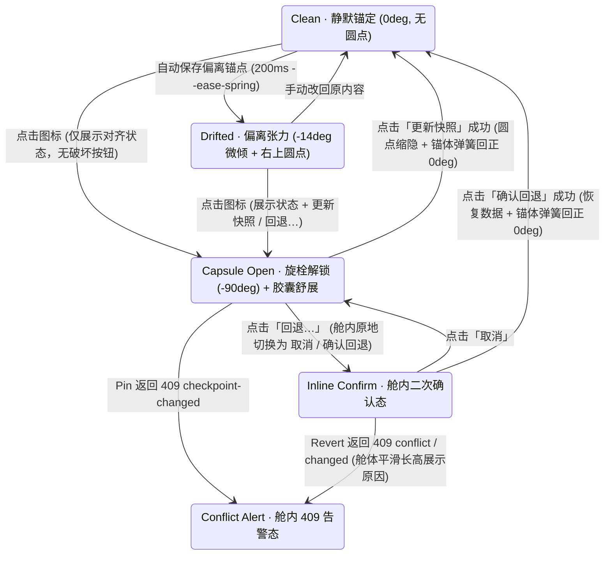

# 通用单层快照前端交互与动效设计 Brief（#238 Layer 3）

承接 [storage-brief.md](./storage-brief.md)（Issue [#238](https://github.com/piepiaspace/effect-tavern/issues/238)）。后端 Phase 1 & Phase 2（对象池、`GET/POST /api/checkpoints/:kind/:id`、双侧乐观锁、`409` 冲突详情与 `call` 去重）已全部合入 `main`。

本文定义 #238 最后一块拼图——覆盖全站 **5 个可编辑资产面**的通用单层快照微控件 `<CheckpointControl />` 的物理隐喻、动态展开编排、组件接缝与验收门禁。

---

## 0. 空间约束与形态选型

五个目标编辑页（制卡工坊、单卡写作设置、写作包、提示词模板 Hat、玩家人设）共享两个硬约束：

1. **顶栏横向极窄**：[packs.tsx](../packages/client/src/packs.tsx) 顶栏已容纳「名称框 + 关联卡标签 + 5 个分栏 Tab + 星标/导出/删除」，[workshop.tsx](../packages/client/src/workshop.tsx) 在 `< 40rem` 手机端已隐藏「预览」文字，[writing.tsx](../packages/client/src/writing.tsx) 顶栏仅占左半栏宽度。
2. **全量自动保存**：敲下第一个字即进入 `drifted` 并持续整个编辑会话。

对照三种候选形态：

| 候选形态 | 为什么不采用 / 采用 |
| :--- | :--- |
| **文档流内横向撑宽胶囊** 或 **顶栏下偏离横条** | 敲下首字即撑挤顶栏导致 Tab 折行，或推挤正文区产生纵向跳动（CLS）；双栏写作页还会左右错高。 |
| **扇形散开纯图标卫星菜单** | 5 个顶栏均紧贴视口右上或分栏边，扇形易被安全区/视口裁切；仅有 `Pin` / `Revert` 两个动作，纯图标易混淆方向，且无处承载「快照时间」「回退二次确认」与「`409` 冲突原因」。 |
| **常驻罗盘锚栓 + 弹簧展开悬浮胶囊舱（采纳）** | 顶栏内**永远只占 1 个图标位**（横纵向绝对零位移）；点击时图标发生机械旋转阻尼反馈，同时紧贴锚点下方沿右上原点以弹簧曲线横向舒展出悬浮胶囊舱；舱内原地平滑形变完成「常态 → 回退二次确认 → 冲突告警」，零模态框套娃。 |

### 两项拍板的产品定则

1. **常驻显示**：无论 `clean` 还是 `drifted`，入口图标始终常驻在顶栏右侧工具图标列中。用户在动手调优脆弱配置（如带 Tool Wrap 的 Hat）之前即可看见安全网存在。
2. **回退必须二次确认**：点击「回退」不会立即覆盖工作态，而是在胶囊舱内原地切换为确认态，二次点击「确认回退」才真正执行。

---

## 1. 图标语义与动态编排（Kinetic Choreography）

### 1.1 图标分工（遵守 `icons.tsx`「一图标一语义」）

在 [packages/client/src/icons.tsx](../packages/client/src/icons.tsx) 新增专属图标，不与既有字段级重置 `Restore`（`ph/arrow-counter-clockwise`）或分支切换 `Checkout`（`ph/git-commit`）混用入口语义：

- **入口触发器 `Anchor`**：`~icons/ph/anchor-simple`（呼应存储契约中的 `anchor` 锚点概念）。
- **更新快照动作 `Pin`**：`~icons/ph/push-pin-simple`（将当前工作态钉为新锚点）。
- **回退快照动作**：在胶囊按钮内搭配既有 `Restore`（`~icons/ph/arrow-counter-clockwise`）+ 明确文字标签。

### 1.2 四态物理动效编排

所有时间、缓动与间距严格取自 [tokens.css](../packages/client/src/tokens.css)（`--dur-1`..`--dur-3`、`--ease`、`--ease-spring`、`--space-*`、`--radius-*`）：



1. **静默锚定态（`status === "clean"`）**
   - 触发器为标准 `.icon.sm`（`writing.tsx` 顶栏为 `.icon`），墨色 `--ink-3`，`Anchor` 垂直正立（`rotate: 0deg`），右上无圆点。
   - 点击展开胶囊舱时，仅展示一行安静的读数：
     - `updatedAt === null`：`与初始基线一致`
     - `updatedAt !== null`：`与快照一致 · HH:mm`（跨日显示 `MM-DD HH:mm`）
   - 下方辅以一行次级说明（`--text-caption`、`--ink-3`）：自动保存偏离后可在此更新锚点或回退。不渲染可误触的动作按钮。

2. **偏离张力态（`status === "drifted"`）**
   - 当 `clean -> drifted` 时，`Anchor` 图标沿 `--dur-3 var(--ease-spring)` **逆时针微倾 `-14deg`**（传达“锚链受拉、已离开基线”的微机械感），墨色提至 `--ink-2`。
   - 触发器右上角以 `scale` 动画浮现一颗 `5px` 实心圆点（背景 `--ink`，外圈 `box-shadow: 0 0 0 var(--space-half) var(--surface-1)` 留出呼吸缝；**不用 `--warn`**，因为编辑偏离是正常创作态，不是配置错误）。

3. **旋栓开舱（`[data-open]`）**
   - 按下瞬间（`:active`）触发器 `scale: 0.95`（`--dur-1`）。
   - 浮层打开期间，触发器内 `Anchor` 沿 `--dur-3 var(--ease-spring)` **旋转至 `-90deg`**，形成旋钮卡口旋开的视觉呼应。
   - 悬浮胶囊舱基于 `@ui-sdk/solid/popover`（`align="end"`、`sideOffset={6}`、`collisionPadding={12}`），设 `transform-origin: top right`（RTL 下自动对应内联末端），入场从 `opacity: 0; scale: 0.86 0.92; translate: 0 calc(-1 * var(--space-1))` 沿 `--dur-3 var(--ease-spring)` 横向舒展到位，外观采用 `--surface-3` + `--shadow-pop` + `--radius-card`。

4. **舱内原地二次确认与冲突长高（零弹窗套娃）**
   - `drifted` 常态下，胶囊舱分为紧凑两层：
     - **状态行**：`已偏离初始基线` 或 `已偏离快照 · <时间>`；
     - **动作轨**（等宽或紧凑并列 `.btn.sm`）：`[ Pin 更新快照 ]` 与 `[ Restore 回退… ]`。
   - **点击「回退…」**：不关闭 Popover，也不弹全屏 `AlertDialog` 遮罩，而是将舱内状态切换为 `confirming`：
     - 状态行切换为确认文案：`放弃未固定的修改，恢复到此快照？`
     - 动作轨切换为：`[ 取消 ]`（`.btn.sm`）与 `[ 确认回退 ]`（`.btn.sm` 危险态：文字与图标使用 `--danger`，背景 `var(--danger-soft)`）。
     - 关闭浮层、`Escape` 或点「取消」均自动重置 `confirming = false`。
   - **遇到 `409` 冲突或并发变更**：
     - 浮层保持打开，利用 `:root` 已声明的 `interpolate-size: allow-keywords` 平滑过渡高度，在舱内渲染 `role="alert"` 提示块（`--warn-soft` 底、`--warn` 字）：
       - `hat-name-taken`：说明快照原名称 `conflict.name` 已被另一模板占用，请先重命名冲突模板后再回退；
       - `missing-references`：列出缺失的写作包或人设（若宿主 store 中无名称则显示 ID），保留当前现场；
       - `checkpoint-changed`：就地用响应携带的最新 `standing` 与 `rev` 刷新组件内部状态，并提示“其他窗口刚更新了内容，请确认后再试”。

5. **移动端与无障碍硬规则**
   - 所有 `:hover` 样式必须包裹在 `@media (hover: hover) and (pointer: fine)` 中，防止触屏点击后残留悬停态。
   - `@media (prefers-reduced-motion: reduce)` 下禁用图标旋转与缩放位移动画，仅保留透明度过渡。
   - `PopoverContent` 内必须包含 `<PopoverTitle class="sr-only">` 为弹层命名，满足屏幕阅读器与 `@ui-sdk` Agent 桥接规范。

---

## 2. Wire 契约与深组件接口

### 2.1 Wire 层注意项（`packages/client/src/wire.ts`）

> [!WARNING]
> **切勿直接用 `got()` 吞掉 `409` 响应体**
> 现有 [`response.ts`](../packages/client/src/response.ts) 的 `responseError` 只保留 `error.code` 与 `error.message`，会丢弃 `409` JSON 载荷里的 `standing`、`rev` 和 `conflict`！

在 [`packages/client/src/wire.ts`](../packages/client/src/wire.ts) 中基于 `@effect-tavern/runtime/src/storage.ts` 的类型新增两个纯通信函数：

```ts
export interface CheckpointStatus {
  standing: CheckpointStanding
  rev?: string
}

export type CheckpointOutcome =
  | ({ ok: true } & CheckpointStatus)
  | ({ ok: false; code: "checkpoint-changed" } & CheckpointStatus)
  | { ok: false; code: "checkpoint-conflict"; conflict: CheckpointConflict }

export const fetchCheckpoint = (kind: CheckpointKind, id: string, signal?: AbortSignal): Promise<CheckpointStatus>
export const mutateCheckpoint = (
  kind: CheckpointKind,
  id: string,
  body: CheckpointMutation,
): Promise<CheckpointOutcome>
```

- `mutateCheckpoint` 对 `200` 返回 `{ ok: true, ...json }`；对 `409` 解析响应 JSON，识别 `code === "checkpoint-changed"` 与 `code === "checkpoint-conflict"` 原样返回结构化分支；其余非 `2xx` 仍抛 `responseError(res)`。

### 2.2 `<CheckpointControl />` 组件契约

新建 `packages/client/src/checkpoint-control.tsx`（样式放入 `controls.css` 或独立 `checkpoint-control.css` 并在 `app.css` `@layer components` 引入，**严禁在 `tokens.css` 之外的 CSS 文件中对 `border-radius / padding / margin / gap` 写任何裸 `px` 或 `rem` 字面量**，`test/tokens.ts` 会拦截）：

```ts
export interface CheckpointControlProps {
  kind: CheckpointKind
  id: string
  /** 宿主每次自动保存落盘或重读完成后变化的值，驱动重拉 GET /checkpoints/:kind/:id */
  watch: unknown
  /** 默认使用 .icon.sm (24px)；writing.tsx 顶栏传 false 以匹配 32px .icon */
  small?: boolean
  /** Pin 前先刷入焦点输入框与防抖队列；返回 false 时中止 Pin（例如工坊保存被闸拒绝） */
  beforePin?: () => Promise<boolean> | boolean
  /** Revert 成功后通知宿主丢弃本地未提交草稿并重拉资产 */
  onReverted: () => Promise<void> | void
}
```

**Solid 2.0 实现守则**：
- 绝不解构 `props`（一律在响应式作用域内读 `props.kind`、`props.id`、`props.watch`）；
- 使用双函数 `createEffect(() => [props.kind, props.id, props.watch] as const, ([kind, id], prev) => { ... })` 拉取最新 `CheckpointStatus`（配合 `AbortController` 取消过期请求；切换 `id` 时立刻清空上一实体的旧状态与冲突提示）；
- 执行 `Pin` 前：先调 `blurField()`，再 `await props.beforePin?.()`；若 `beforePin` 触发了新的落盘，需确保拿到最新 `CheckpointStatus`（可在 `beforePin` 后重读一次 `fetchCheckpoint` 再发 `mutateCheckpoint({ action: "pin", ... })`，彻底避免工坊 `800ms` 防抖刚刷盘导致 `expectedWorkingHash` 滞后一拍！）。

---

## 3. 五个资产编辑面的精确挂载清单

| 资产面 (`kind`) | 宿主文件与顶栏位置 | `id` 来源 | `watch` 信号 | `beforePin` 钩子 | `onReverted` 恢复动作 |
| :--- | :--- | :--- | :--- | :--- | :--- |
| **`card`**（制卡工坊） | [`workshop.tsx`](../packages/client/src/workshop.tsx) `ManuscriptPage` `.workshop-end` 内，置于导出 `<a>` 之前 | `id()`（`at()`） | `[standing(), busy()]`（仅 `!busy()` 时稳定重读） | `async () => (blurField(), (await here()?.desk?.flush()) ?? false)` | `async () => { reread(); await fetchCards() }`（`reread()` 内部已调 `desk.letGo()` 取消 `800ms` 定时器并重读 `wholeCard`） |
| **`local`**（单卡写作台） | [`writing.tsx`](../packages/client/src/writing.tsx) `.whead` 右侧，`Stack` 预览按钮之左（`small={false}`） | `cardId()` | `loc()` | `async () => { blurField(); await pendingLocalWrite(); return true }` | `async () => { await fetchLocal(cardId()); await refreshActiveCard() }`（兼容普通卡与自由对话卡） |
| **`pack`**（写作包） | [`packs.tsx`](../packages/client/src/packs.tsx) `.pack-detail-header` 右侧，星标按钮之左 | `p().id` | `p()` | `async () => { blurField(); await pendingPackWrite(); return true }` | `async () => { await fetchPacks(); await refreshActiveCard() }` |
| **`hat`**（提示词模板） | [`settings.tsx`](../packages/client/src/settings.tsx) `Templates` `.hat-detail-header` 右侧，导出按钮之左 | `h().id` | `savedHat()` | `async () => { commitPending(); return await saving }` | `async () => { setDraft(null); setFailure(null); await fetchHats() }`（清掉本地 `draft` 防止盖回旧内容） |
| **`persona`**（玩家人设） | [`settings.tsx`](../packages/client/src/settings.tsx) `Personas` `.detail-header` 右侧，星标按钮之左 | `x().id` | `x()` | `() => (blurField(), true)` | `async () => { await fetchPersonas(); await refreshActiveCard() }` |

---

## 4. 国际化与完成验收门禁（Completion Criteria）

1. **双语词条对齐（`x18n check`）**
   - 在 [`locales/zh-CN.ts`](../packages/client/src/locales/zh-CN.ts) 与 [`locales/en.ts`](../packages/client/src/locales/en.ts) 对称补齐 `checkpoint.*` 词条（触发器无障碍名、对齐/偏离状态文案、初始基线 vs 带时间快照、`更新快照`、`回退…`、`确认回退`、二次确认提示，以及三类 `409` 冲突的人话说明）。
2. **令牌与依赖边界门禁**
   - 新增样式不引入未在 `tokens.css` 声明的 CSS 变量，不在 `border-radius / padding / margin / gap` 中写裸数值（通过 `packages/client/test/tokens.ts`）。
   - 仅从 `@effect-tavern/runtime/src/storage.ts` 导入纯类型或纯契约（通过 `packages/client/test/imports.ts` 浏览器包边界检查）。
3. **无头浏览器 Agent 与 Solid 2.0 诊断验证（`vp run verify:ui`）**
   - 在 [`packages/client/test/controls.tsx`](../packages/client/test/controls.tsx) 的假服务端路由中桩好 `GET/POST /checkpoints/...`，挂载 `<CheckpointControl />`，通过 `createAgent`（`snapshot` / `act`）走完：
     1. `clean` 态打开查看基线信息；
     2. 切换为 `drifted` 态打开胶囊 -> 点「回退…」进入舱内确认态 -> 点「取消」退回 -> 再次点「回退…」并「确认回退」触发 `onReverted`；
     3. 模拟返回 `409 checkpoint-conflict`（如 `hat-name-taken`），断言舱内渲染冲突文本且现场保留；
     4. 点「更新快照」先执行 `beforePin` 再发 `pin`，完成后回到 `clean`。
   - 在 [`packages/client/test/workshop.tsx`](../packages/client/test/workshop.tsx) 的工坊假服务端中补齐 `GET /checkpoints/card/:id` 桩，确保工坊浏览器回归绿灯且零 Solid 诊断告警（`expectNoDiagnostics`）。
4. **全套验证命令全绿**
   - `vp check`
   - `cd packages/client && vp run verify && vp run verify:ui`
