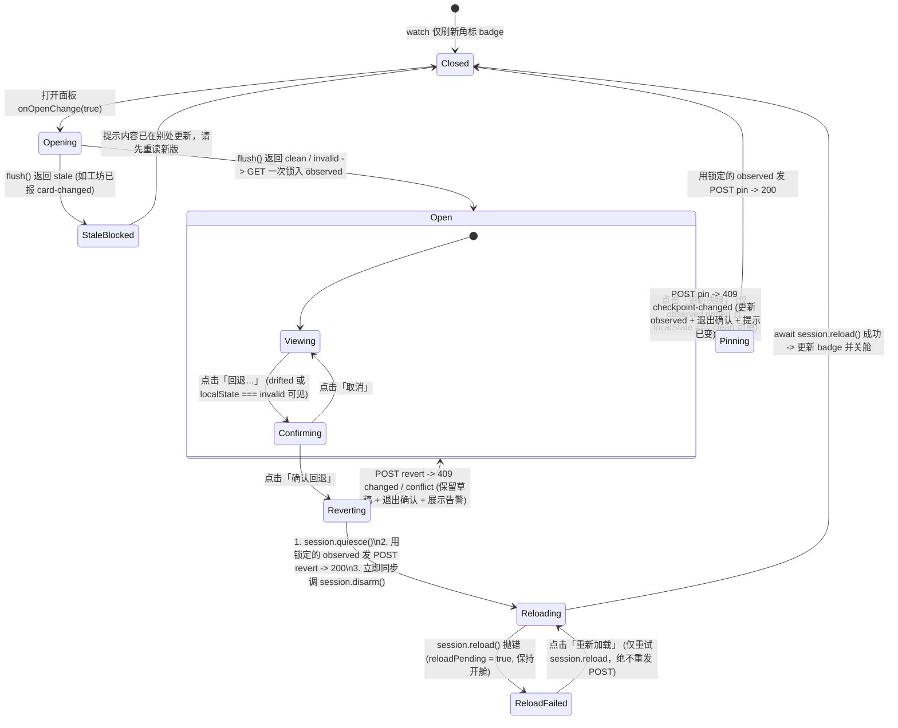

# 通用单层快照前端架构、状态机与交互设计 Brief（#238 Layer 3 收敛定稿）

承接 [storage-brief.md](./storage-brief.md)（Issue [#238](https://github.com/piepiaspace/effect-tavern/issues/238)）。后端对象池、`GET/POST /checkpoints/:kind/:id`、双侧乐观锁、`409` 冲突载荷与 `call` 追踪去重已合入 `main`；前端 `<CheckpointControl />` 的视觉样式、图标与弹簧动效也已在 `88890b4` 就位。

本文定稿前端**逻辑与数据流收敛方案**：在不改动现有视觉动效与后端契约的前提下，统一五个资产编辑面的**行级函数式写队列、开舱定帧（`observed`）乐观锁状态机、本地草稿止损生命周期与回退后可等待重读**，根除跨控件覆盖、跨标签页误吞修改、坏草稿卡死回退及回退后缓存滞后四类问题。

---

## 0. 既有视觉与动效基线（保持不变）

[`packages/client/src/checkpoint-control.css`](../packages/client/src/checkpoint-control.css) 与 [`packages/client/src/icons.tsx`](../packages/client/src/icons.tsx) 已完成的视觉与无障碍基线保持原样：

1. **常驻单图标触发器**：顶栏固定占 1 个图标位（默认 `.icon.sm`，[`writing.tsx`](../packages/client/src/writing.tsx) 为 `.icon`），横纵向零位移。`clean` 态 `Anchor` 正立（`0deg`）；偏离态微倾 `-14deg` 并浮现右上 `5px` `--ink` 圆点；开舱（`[data-open]`）旋至 `-90deg`。
2. **悬浮胶囊舱与原地二次确认**：基于 `@ui-sdk/solid/popover`（`align="end"`、`sideOffset={6}`、`collisionPadding={12}`、含 `<PopoverTitle class="sr-only">`）。点击「回退…」在舱内原地切换为「取消 / 确认回退」，零嵌套模态框。
3. **移动端与令牌门禁**：`:hover` 仅在 `@media (hover: hover) and (pointer: fine)` 生效；动效包裹在 `@media (prefers-reduced-motion: no-preference)` 中；除 `tokens.css` 外不在 `border-radius / padding / margin / gap` 中写裸 `px` 或 `rem`。

---

## 1. 底层收敛：Wire 写队列与回退刷新（`packages/client/src/wire.ts`）

### 1.1 行编辑复用串行函数式队列（消除同手势字段互踩）

在 [`wire.ts`](../packages/client/src/wire.ts) 内抽出轻量的串行队列构造器，供 `local`、`pack`、`persona` 各自实例化独立队列（`routing` 保持现有 `putRouting` 实现）：

- **将 `putPersona` 改为与 `putPack`、`putLocal` 一致的函数式更新签名**：
  ```ts
  export const putPersona = (id: string, edit: (p: Persona) => Persona): Promise<void>
  ```
  队列轮到当前任务执行时，从 `registry.get(personas)` 读取上一笔已确认的最新行（新建尚不存在时回退至 `{ id, name: "", text: "" }`）再应用 `edit`。
  这样在 [`settings.tsx`](../packages/client/src/settings.tsx) 的 `Personas` 中，「正文 `<textarea>` 失焦保存 `{ ...p, text }`」与「紧接着点击星标保存 `{ ...p, default: !p.default }`」按序叠加各自的字段，不会再用旧快照覆盖刚输入的新正文。
- **区分每次写入的完成结果与队列排空**：
  - `putPersona` / `putPack` / `putLocal` 返回**当次写入自身**的 `Promise<void>`（失败时正常 reject，供调用方感知保存失败）；
  - 队列实例维护内部尾指针，暴露不抛错的排空等待 `settleAssetWrites(kind)`（供 Revert 等待已在途请求结束），以及可感知最近一次排空是否出错的冲刷等待（或由宿主会话判断）。

### 1.2 集中回退重拉入口 `reloadAsset`，普通写入保持按用户动作刷新

- **回退刷新集中化**：在 `wire.ts` 提供统一的可等待函数 `reloadAsset(kind: CheckpointKind, id: string): Promise<void>`：
  - `card`：`await fetchCards()` + `await refreshActiveCard()`（工坊自身的整卡手稿重读由工坊 `session.reload` 一并等待，见 §3.1）；
  - `local`：`await fetchLocal(id)` + `await refreshActiveCard()`；
  - `pack`：`await fetchPacks()` + `await refreshActiveCard()`；
  - `persona`：`await fetchPersonas()` + `await refreshActiveCard()`；
  - `hat`：`await fetchHats()`。
- **普通写入不盲目内嵌 `refreshActiveCard()`**：
  保留普通写入在**完整用户动作结束处**触发 `refreshActiveCard()` 的现有边界。例如 [`dialogs.tsx`](../packages/client/src/dialogs.tsx) 批量重命名/删除公共标签时会对多张卡循环调用 `putLocal`，切换人设时需先写 `putLocal` 再写空故事 `pickStoryPersona` 最后刷新一次——`putLocal` 本身只更新 `locals` 与匹配的 `card.local`，避免一次点击触发 20 次 `refreshActiveCard()`。

---

## 2. 中层契约：编辑器会话 `CheckpointSession`

“写队列已排空”不等于“屏幕上的内容已保存”。工坊有 `800ms` 防抖与校验失败态，模板编辑器（`Templates`）除了父级 `draft` 外，子控件 `DeliveryTool`（非法工具名暂存在局部 `typed`）与 `SlotCapsule`（非法工具 JSON 暂存在局部 `badToolInput`）也会持有未进入保存队列的临时输入。

为此定义窄而正交的编辑器会话接口：

```ts
export type FlushOutcome =
  | { state: "clean" } // 本地输入已全部落盘，屏幕与服务端工作态一致
  | { state: "invalid" } // 已在途写入已排空，但屏幕仍留有校验失败/未落盘的本地输入
  | { state: "stale" } // 本地保存已收到服务端版本冲突（如工坊 409 card-changed），本地落后于书架

export interface CheckpointSession {
  /** 开舱时调用：blurField() 后尝试将本地待定修改落盘，并报告屏幕真实状态。 */
  flush(): Promise<FlushOutcome>

  /** Revert 发送 POST 前调用：暂停未发出的本地防抖计时器，仅等待已在途的网络写入结束。
   *  不重发失败草稿，也不清空屏幕内容（若 POST 返回 409，用户现场必须完整保留）。 */
  quiesce(): Promise<void>

  /** POST revert 返回 200 的瞬间同步调用：立即剥夺旧草稿的写回资格（如工坊 desk.letGo、
   *  模板清空 draft 与子控件临时输入），防止页面隐藏或卸载钩子把已丢弃的草稿再次写回。 */
  disarm(): void

  /** POST revert 成功后（及重读失败点重试时）调用：拉取最新资产与关联视图，待编辑器真正装入新内容后 resolve。 */
  reload(): Promise<void>
}
```

- **默认会话（`persona`、`pack`、`local`）**：当宿主未传自定义 `session` 时，`<CheckpointControl />` 使用基于 `wire.ts` 的默认实现：
  - `flush()`：`blurField()` 后等待对应写队列落定；若刚才触发的写入抛错则视为 `{ state: "invalid" }`（或直接向上报错），否则返回 `{ state: "clean" }`；
  - `quiesce()`：`await settleAssetWrites(kind)`；
  - `disarm()`：空操作（无页面级自动保存卸载钩子）；
  - `reload()`：`await reloadAsset(kind, id)`（若有空白未持久化的子项草稿，可通过页面可选的轻量重置回调一并归零）。
- **自定义会话（`card` 工坊、`hat` 提示词模板）**：由最了解自身草稿结构的编辑器提供 `session`（细则见 §3）。

---

## 3. 顶层状态机：开舱定帧（`observed`）与单路径回退

### 3.1 核心状态与流转图

组件内部严格分离**后台角标状态**与**面板打开期间锁定的确认基准**：

- `badge: CheckpointStatus | null`：随 `[props.kind, props.id, props.watch]` 在后台更新，仅驱动顶栏锚点图标在未开舱时的正立/微倾状态。
- `observed: ({ kind: CheckpointKind; id: string } & CheckpointStatus) | null`：**仅在打开面板完成 `flush()` 后读取一次并锁定**。面板开着时，后台 `watch` 刷新不得替换用户正在确认的 `observed`。`Pin` 与确认 `Revert` 一律提交这份 `observed` 中的哈希与 `rev`，**绝不在点击「更新快照」或「确认回退」时重发 `GET`**。
- `localState: "clean" | "invalid" | "stale"`：记录开舱 `flush()` 报告的本地屏幕状态。
- `reloadPending: boolean`：仅当 `POST revert` 已返回 `200`（旧草稿已 `disarm()`），但随后的 `await session.reload()` 失败时置为 `true`。



### 3.2 四条关键行为不变量

1. **连 `Clean + 本地坏草稿` 也走同一个 `POST revert`（零特判分支）**：
   - 当 `observed.standing.status === "clean"` 且 `localState === "invalid"`（例如刚打开新卡/新模板就输入了非法宏或非法工具名，服务端尚未偏离，但屏幕草稿已坏）时：
     - 「更新快照」按钮禁用（未保存内容不可钉锚）；
     - 「回退…」按钮可用，确认后**照常携带 `observed` 发送 `POST revert`**。
   - 后端 [`decideCheckpoint`](../packages/server/src/checkpoint.ts#L32-L38) 先校验 `(expectedWorkingHash, expectedAnchorHash, rev)` 再做幂等短路：若期间无其他窗口修改，服务端幂等返回 `200`；若另一窗口刚保存了新内容，服务端精准返回 `409 checkpoint-changed` 保护另一窗口的正文不被本地重读冲掉。
2. **工坊 `card-changed` 开舱即拦（`StaleBlocked`）**：
   - 若打开面板时工坊已处于 `standing().is === "changed"`（此前自动保存已撞上 `409 card-changed`），`flush()` 返回 `{ state: "stale" }`。此时用户屏幕看到的仍是旧稿而非书架新版，面板直接展示 `checkpoint.conflictChanged` 告警并隐藏/禁用 `Pin` 与 `Revert`，引导用户先看新版，避免盲目操作覆盖他人修改。
3. **旧草稿失去写回资格的精确时点 = `POST revert` 返回 `200`**：
   - `POST revert` 返回 `409` 时：未调 `disarm()`，用户的草稿完整留在编辑器里可继续修改。
   - `POST revert` 返回 `200` 时：立刻同步执行 `session.disarm()`，停掉工坊 `visibilitychange` / 卸载保存（[`workshop.tsx`](../packages/client/src/workshop.tsx#L302-L317)）与模板卸载保存（[`settings.tsx`](../packages/client/src/settings.tsx#L504-L506)），随后再 `await session.reload()`。
4. **回退成功后若重读失败，只重试读取**：
   - 若 `await session.reload()` 抛错，面板保持打开并进入 `reloadPending = true`：`role="alert"` 显示“已回退到快照，重新加载失败”，动作区仅渲染单个「重新加载」按钮，点击只重新执行 `await session.reload()`，成功后关闭面板。若切换实体 `[kind, id]` 则清空该状态。

---

## 4. 五个资产编辑面的对接细则

| 资产面 (`kind`) | 宿主文件 | 接入方式与草稿生命周期要点 |
| :--- | :--- | :--- |
| **`card`**（制卡工坊） | [`workshop.tsx`](../packages/client/src/workshop.tsx) | 提供自定义 `session`：<br>1. `flush()`：`blurField()` 后调 `desk.flush()`；返回 `true` 为 `clean`；返回 `false` 时若 `standing().is === "changed"` 为 `stale`，否则为 `invalid`。<br>2. `quiesce()`：`desk.pause()` 并等待 `desk` 当前在途 `queue` 结束（为 `desk` 暴露不触发新保存的 `settle()`）。<br>3. `disarm()`：`desk.letGo()`。<br>4. **可等待的 `reload()`**：将重读改为返回 `Promise<void>` 的异步函数（并行执行 `wholeCard(id)` 与 `reloadAsset("card", id)`，拿到新 `{ card, rev }` 后原地替换 `opened` 的 `desk`、`manuscript` 与 `standing({ is: "clean" })`，无需先 `setOpened(null)` 卸载顶栏），待整卡装入编辑器且书架、当前游玩视图 `card` 均更新完毕后才 resolve。 |
| **`hat`**（提示词模板） | [`settings.tsx`](../packages/client/src/settings.tsx) `Templates` | 提供自定义 `session`：<br>1. 让 `DeliveryTool`（非法工具名 `typed`）与 `SlotCapsule`（非法工具入参 `badToolInput`）向 `Templates` 报告是否存在未入队的非法输入，并订阅一个重置计数（`resetSeq`）。<br>2. `flush()`：`commitPending()` 后等待 `saving`；若 `saving` 返回 `false`、`failure()?.id === id` 或子控件存在非法输入，返回 `invalid`，否则返回 `clean`。<br>3. `quiesce()`：仅等待已在途的 `saving` 结束。<br>4. `disarm()`：清空 `draft`、`failure`，递增 `resetSeq` 清掉子控件的非法临时文字，确保卸载钩子不再保存旧 `draft`。<br>5. `reload()`：`await reloadAsset("hat", id)` 后调 `forgetPreviewHat(id)`。 |
| **`persona`**（玩家人设） | [`settings.tsx`](../packages/client/src/settings.tsx) `Personas` | 将新建、改名、切换默认星标、修改正文全部改为调用函数式 `putPersona(id, (p) => ...)`（用户动作末尾保留一次 `.then(refreshActiveCard)`）；挂载 `<CheckpointControl kind="persona" id={x().id} watch={x()} />` 使用默认会话。 |
| **`pack`**（写作包） | [`packs.tsx`](../packages/client/src/packs.tsx) | 挂载 `<CheckpointControl kind="pack" id={p().id} watch={p()} />`（可选在 `reload` 后重置分栏内尚未持久化的空白新增草稿行）。 |
| **`local`**（单卡写作台） | [`writing.tsx`](../packages/client/src/writing.tsx) | 挂载 `<CheckpointControl kind="local" id={cardId()} watch={loc()} small={false} />`（同上，兼容普通卡与自由对话卡）。 |

---

## 5. 文案增量与完成验收门禁（Completion Criteria）

### 5.1 双语词条（`x18n check`）

在 [`locales/zh-CN.ts`](../packages/client/src/locales/zh-CN.ts) 与 [`locales/en.ts`](../packages/client/src/locales/en.ts) 的 `checkpoint.*` 中对称补齐两项词条（其余既有词条保留）：
- 本地存在未保存修改时的偏离状态提示（当服务端 `standing.status === "clean"` 但 `localState === "invalid"` 时使用，避免显示自相矛盾的“与快照一致”）；
- 回退成功但重新加载失败时的提示文案与「重新加载」按钮文案（如 `reloadFailed`、`retryReload`）。

### 5.2 必过定向回归用例

在无头浏览器测试（[`packages/client/test/controls.tsx`](../packages/client/test/controls.tsx)、[`packages/client/test/workshop.tsx`](../packages/client/test/workshop.tsx) 及相关客户端测试）中覆盖并断言以下五个真实场景：

1. **人设同手势连续编辑不丢字**：修改人设正文后不先点击空白处，直接点击「设为默认」星标，断言发出的第二次 `PUT /personas/:id` 同时保留新正文与新的 `default` 标志。
2. **跨标签页确认回退不误吞新改动**：页面 A 打开胶囊并进入「确认回退」态 → 模拟页面 B 保存同一资产推进服务端 `workingHash`（及卡片 `rev`）→ 页面 A 点击「确认回退」，断言客户端携带打开面板时锁定的旧 `observed` 请求 `POST revert`、收到 `409 checkpoint-changed`、不触发 `reload`、展示冲突提示并保留现场。
3. **输入非法内容后仍可顺利回退止损**：
   - 在工坊输入非法宏导致保存失败后打开快照面板，断言「更新快照」不可用、「回退…」可用，确认回退后非法草稿被丢弃并恢复为快照内容；
   - 在模板编辑器 `DeliveryTool` 输入非法工具名后打开快照面板，断言「更新快照」不可用，确认回退后子控件输入框恢复为快照中的合法工具名。
4. **工坊回退后直接去游玩拿到新内容**：在尚未开始故事的卡片上修改标题并保存 → 回退到快照 → 点击「去游玩」，断言工坊手稿、书架列表与游玩页 `CardPage` 标题均已恢复为快照版本，零旧缓存残留。
5. **回退成功但重读失败时仅重试读取**：模拟 `POST revert` 返回 `200` 后首次重读 `GET` 抛错，断言旧草稿已停写、面板保持打开显示重读失败提示，点击「重新加载」只重发 `GET` 而不重发 `POST revert`，成功后正常关舱。

### 5.3 全量门禁

- `bun tools/mdlint/index.ts`
- `vp check`
- `cd packages/client && vp run verify && vp run verify:ui`
