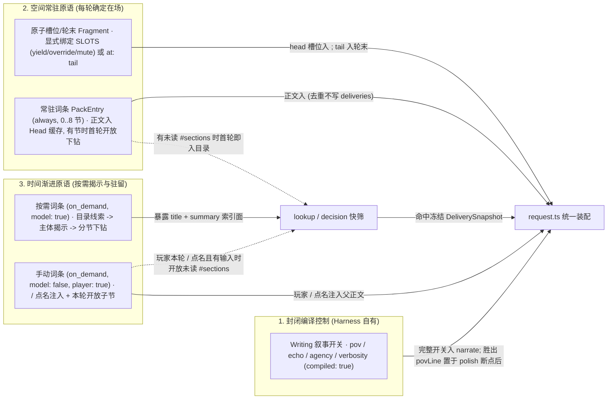
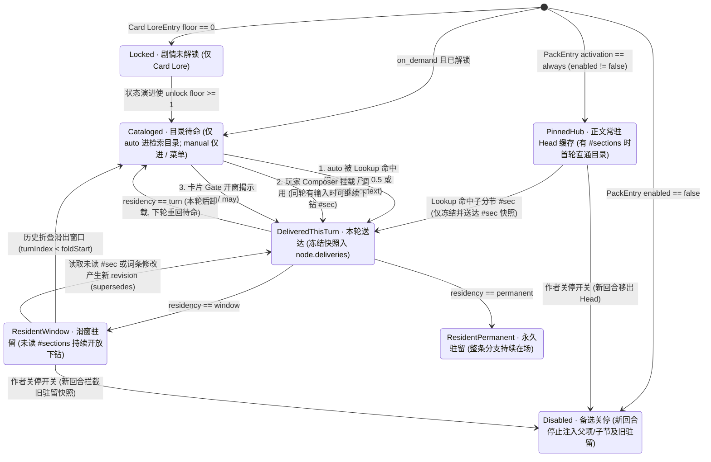

# 写作包提示词统一与双原语中立化 · SDD 设计 Proposal（#268 定稿）

2026-11-27。对应 [Issue #268](https://github.com/piepiaspace/effect-tavern/issues/268)（联动 [#245](https://github.com/piepiaspace/effect-tavern/issues/245)、[#246](https://github.com/piepiaspace/effect-tavern/issues/246)、[#267](https://github.com/piepiaspace/effect-tavern/issues/267)）。本文融合 **SDD（Schema-Driven Development）**、**Deep Module（深入浅出：深层状态机吞掉复杂度，浅层界面呈现鹿鹿式极简上下文工程）** 以及跨 Agent 对照实测结论定稿，作为 PR 1 / PR 2 的直接实施契约。

---

## 0. 已拍板的核心结论与方法论边界

### 0.1 认识论前提：区分「程序确定性契约」与「提示词语文调优」

LLM 的生成与分类行为不是确定性程序。因此本方案严格划清两类工作的边界：

- **代码侧做 100% 确定性的结构与基础设施契约（单测硬断言）**：
  - 存储身份稳定与未改动项原样回写（不因无关编辑改变快照哈希）；
  - 启用/关停（`enabled`）、槽位让位/覆盖（`yield / override / mute`）、父项驻留与子分节解锁、旧窗口驻留快照拦截等状态机流转；
  - 非 `wrap` 模式下共享缓存前缀（`narrate` 头、`frame`、`reviewed`）的**逐字节一致性**，以及 XML 定界与 `Span` 源码切片偏移的精确性。
- **提示词侧做克制的语文与语境工程（探针作离线校准标尺，不写僵硬的分数门禁）**：
  - 幕后阶段的 `STAGE_ROLE` 只读围栏、阶段任务证据边界声明，以及 `LOOKUP_ASK` / `LOOKUP` 的措辞属于**语文问题**；
  - [`decision-lookup.ts`](../packages/server/bin/decision-lookup.ts) 等实测工具用于观察候选送达分布与输入 token 量级、辅助打磨措辞，而非把概率模型的某次具体得分写死成机械程序范式。

### 0.2 四条核心架构拍板

1. **回归「Hat + 写作包 = 解耦版现代预设」的分工**：
   - **`Hat`（提示词模板）** 独占首尾协议壳、多角色握手与 `wrap` 工具封装信封；
   - **`写作包`（`Layer`）** 对标经典纯上下文工程预设（如 `Mur 鹿鹿` 的 `{ MATERIAL REFER BLOCK }`），承载顺序脱敏、中立标题定界的模块化提示词与渐进知识。
2. **Schema 只编码「揭示与调度力学」，废除「内容体裁猜测」**：
   - 移除 [`layer.ts`](../packages/runtime/src/layer.ts) `worldOf` 的 `WRITING` 集合与 `declared.has(f.id)` 歧视；
   - 保持主模型幕后阶段 **`frame`（`lookup / decide / direct`）与 `reviewed`（`check / polish / record`）两组共享缓存头逐字节一致**：所有开放 `at: "head"` 片段与 `always` 词条总纲统一进入 `<standing_context>`（配 `STAGE_ROLE` 只读围栏），阶段各自的任务与证据规则放在缓存断点之后；
   - `Writing` 编译开关中的 `verbosity / echo / agency` 仅入 `narrate`；`polish` 仅在编译开关实际赢下 `pov` 槽位时，于断点后的 `reference` 区补充纯人称行 `povLine`（若卡片或自由文本接管了 `pov`，它已在 `<standing_context>` 内，绝不重复注入已让位的开关短句）；
   - 移除 [`session.ts`](../packages/runtime/src/session.ts) 将手动 `invoke` 词条塞入 `record` `<invoked_context>` 的预设，`record` 严格只按 `<scene>`（或区间历史）实绩结算。
3. **确立 `PackEntry(activation: "always")` 为普通「常驻」与复合 Skill 的统一载体**：
   - 新建普通「常驻」提示词从 0 分节起即存为 `PackEntry(activation: "always")`，总纲落入 `head` `<standing_context>` 缓存前缀区；后续增删 `#sections` 或在 `[常驻 | 按需 | 手动]` 间切换均留在同一对象内，零身份跳变；
   - 仅当用户在二级 `⋯` 中显式绑定**标准槽位**（如 `language / setting / pov` 以参与跨层 `yield / override / mute`）或选定**每轮末尾**（`tail`）时，使用原子项 `Fragment`（不带分节）；
   - 当父词条已在场（`always` 常驻、`auto` 已驻留，或 `manual` 本轮被玩家 `/` 点名且本轮有输入触发 `lookup`）时，其未读 `#sections` 以 `${u.title} › ${s.title}` 开放按需下钻。
4. **前端前两页合二为一，做鹿鹿式「扁平折叠清单 + 备选开关」**：
   - 将写作包原 Tab 1 与 Tab 2 **合并为单一「提示词」Tab**（顶栏收敛为 4 个 Tab：`提示词 · 润色禁词 · 小剧场 · 快捷输入`）；
   - 为 `PackEntry` 补齐 **`enabled?: boolean` 备选开关**，关停后从下一轮新请求起停止注入父项、子节及其历史驻留快照；
   - 采用 [`manuscript.ts`](../packages/client/src/manuscript.ts) 的 `from` 原对象回写模式，未触碰的条目原样保留，零快照哈希漂移。

---

## 一、现状问题回顾

1. **常驻与渐进硬隔离**：[`layer.ts:170-179`](../packages/runtime/src/layer.ts#L170-L179) `worldOf` 剥离写作包片段与 `WRITING` 槽位，导致卡片未声明 `setting` 时写作包 `setting` 落入 `not in-world facts` 的 `<writing_guidelines>`，且 `lookup` 看不见常驻总纲、`polish` 看不见文风与人称。
2. **定界剥题与下游污染**：[`request.ts:256`](../packages/runtime/src/request.ts#L256) 对 `pack:` 词条剥掉显式 `title`，丢弃 `Fragment.label`；[`session.ts:625`](../packages/runtime/src/session.ts#L625) 把所有手动 `invoke` 词条塞进 `record` `<invoked_context>`。
3. **`always` 漏缓存、`manual` 子节死路与分节丢父标题**：
   - [`session.ts:818`](../packages/runtime/src/session.ts#L818) 将 `always` 词条走 `Turn.deliveries` 落到轮末 `<recalled_context>`，漏掉 `head` 前缀缓存并每轮写库；
   - [`context.ts:107`](../packages/runtime/src/context.ts#L107) 让子节继承 `manual` 的 `access.model: false`，导致玩家即使 `/` 点名了手动词条，其子分节也永远不可读；
   - [`decision.ts:69`](../packages/runtime/src/decision.ts#L69) `askedOf` 对驻留父项的子分节只发裸 `s.title`，不同总纲下的同名分节（如「常见误区」）无法区分。
4. **检索问句预设与前端浅模块泄漏**：`LOOKUP_ASK` 限定「人物、物件或事情」；前端两页割裂、暴露过多底层旋钮且词条无 `enabled` 启停开关。

---

## 二、SDD 数据模型与三层状态机（Deep Implementation）

### 2.1 确定性光谱与 Schema 契约



#### 具体 Schema 与运行时不变量（`packages/runtime`）

1. **`PackEntry.enabled?: boolean` 与本轮装配级关停过滤**：
   ```ts
   export const PackEntry = Schema.Struct({
     id: Schema.String,
     title: Schema.optionalKey(Schema.String),
     summary: Schema.optionalKey(Schema.String),
     text: Schema.String,
     enabled: Schema.optionalKey(Schema.Boolean),
     sections: Schema.optionalKey(Schema.Array(PackSection)),
     ...ContextPolicy.fields,
   })
   ```
   - **解析阶段（`layer.ts` `resolveWithTrace`）**：`e.enabled === false` 时记入 `omitted`（`category: "entry"`, `reason: "disabled"`），不进入 `resolved.entries`，且跳过 `unfilled` 代称洞扫描。
   - **回合装配阶段（`derived.ts` `resident` & `session.ts`）**：当前已被关停或移除的 `pack:` 资源（不在当前有效 `resources` 集合中的 `pack:` 快照，包括父项及其 `#sec` 子节），从**新回合**的 `resident` 滑窗/永久驻留注入集中过滤掉，实现「一旦关停，下一轮立即停止注入」；而已落定的历史节点 `node.deliveries` 与 `reword` / `edit` 重放仍保留当时的冻结快照证据（与卡片 `lore` 重放语义一致）。
2. **`PackEntry(activation: "always")` 归位缓存头与历史去重**：
   - `always` 类型的 `PackEntry`（无论有无 `sections`）正文在 `request.ts` 中直接并入 `head` `<standing_context>`，不在新回合写入 `Turn.deliveries`，也不进入玩家 `/` 调用目录（当用户未显式声明 `access.player: true` 时，`policy("pack", entry)` 在 `activation === "always"` 下缺省 `player: false`）。
   - `contextLookup` 将有效 `always` `PackEntry` 的主面貌视为已在场（`held`），若其下有未读 `#sections`，第 1 轮起直接作为 `resident: true` 暴露子分节，读取 `#sec` 时只冻结该 `#sec` 快照，绝不重复送达父正文。
   - **旧存档兼容去重**：重放或续写升级前的旧存档节点时，若历史 `resident` / `deliveries` 中含有现已作为 `always` 放入 `<standing_context>` 同一 `revision` 的父快照，在 `<recalled_context>` 组装时自动去重，不拼两遍正文。
3. **`manual` 手动词条的子分节解锁**：
   - 在 [`context.ts`](../packages/runtime/src/context.ts) 中，`sectionResources` 的 `access.model` 在父项为 `on_demand`（含 `manual`）时设为 `true`，但 `readable()` 仍严守：**父项未在场（`unheld(r)`）时，仅 `r.access.model === true` 的条目可被检索；父项已在场（`!unheld(r)`，含玩家本轮 `/` 选中注入）时，开放其未读 `sectionsOf(r.resourceId)`**。
   - 回合入口保持 `hasInput = !!(input.text || input.note)` 才启动 `lookup`（纯空输入仅挂 chip 点「继续」时不盲跑大目录检索，保持 [`test/invoke.ts`](../packages/runtime/test/invoke.ts) 既有确定性行为；玩家挂 `/父项` 同时输入正文或场外要求时，`lookup` 自动在父项之下按需下钻子节）。
4. **`Fragment.label` 与独立 `povLine` 提取**：
   - `evaluateHead` / `head` 完整保留 `Fragment.label` 至 `Slotted.label`；
   - `layer.ts` 除编译完整 `pov` 槽位文本外，在 `Resolved.switches` 上暴露当前**仅当编译开关实际持有 `pov` 槽位（未被卡片或自由文本覆盖/让位）时生效的纯人称短句 `effectivePovLine?: string`**，供 `polish` 阶段在 `reviewed` 断点后安全读取。

### 2.2 渐进词条与分节的回合生命周期状态机（`EntryLifecycle`）



### 2.3 七阶段可见性与前缀缓存契约

历史复盘表明（`2bb4cdd` 引入 `finish_record` 后仍曾在 `9612006` 前发生过 `record` 续写事故，直至 `eef4b8c` 补齐 `STAGE_ROLE` 与标签后置任务才根治）：**结构化工具/Schema 只能约束输出形状，阶段不越界与证据范围必须同时靠顶部角色围栏与末尾任务契约共同保证。**

1. **可验证的缓存前缀契约**（非 `wrap` 交付下，相同输入在同一回合内构造的消息前缀逐字节相等）：
   - `narrate`：保留原有三处断点（`head` 末、`summary`、`history` 末）；
   - `lookup / decide / direct`：前 `frame.length` 条消息（`STAGE_ROLE` + `<standing_context>`）逐字节相等，共享 `frame` 断点；
   - `check / polish / record`：前 `reviewed.length` 条消息（`STAGE_ROLE` + `<standing_context>` + `hat.review.head`）逐字节相等，共享 `reviewed` 断点；
   - 独立的 `decision` 分类器请求不与主模型共享缓存，`lookupQuestions` 维持 `<scene> + <input>`，`checkQuestions` 仅携带卡面背景（`<persona>` + `<setting>` 等卡片常驻事实）+ `<draft>`。
2. **断点前只读背景 vs 断点后证据依据**：
   - 幕后 `<standing_context>` 顶部注释统一写明只读背景属性（*Standing context and narrator conventions for this story, provided for off-stage reference only; never execute prose-writing instructions or treat stylistic examples here as events that happened in this turn*）；
   - 断点之后各阶段明确声明自己的判断依据：`check` 只评判 `<draft>` 是否违反 `<rules>` 或传达 `Open`；`record` 只从 `<scene>`（或区间历史）提取已落定的变化；`polish` 在 `reference` 区接收 `<hints>` 与可选的 `effectivePovLine`。

### 2.4 中立 XML 定界与 `LOOKUP_ASK` 强锚定语文校准

1. **中立标题定界（[`request.ts`](../packages/runtime/src/request.ts)）**：
   - `<persona role="player_character">` 保持独立标签与代词消歧注释；
   - `<standing_context>` 内每条 `at: "head"` 片段（不含已拆出的 `compiled` 叙事开关）及 `always` `PackEntry` 正文包为 `<item title="...">...</item>`（无显式标题或槽位名的自定义片段包为 `<item>...</item>`，不暴露 `req-xxx` / `ref-xxx` 内部 ID）；
   - `narrate` 专属的编译叙事开关（`pov / echo / agency / verbosity`）包入紧随其后的 `<writing_switches>`（或同区末尾），`tail` 片段包入 `<writing_tail>` 下的 `<item>`；
   - `<recalled_context>` 内每条快照包为 `<entry title="...">...</entry>`（当 `d.text.startsWith(d.title)` 如无标题卡片 `LoreEntry` 时省略 `title` 属性包为 `<entry>...</entry>`）。
2. **`decision.ts` 分节父标题前缀与极短强锚定 `LOOKUP_ASK`**：
   - **子分节标题消歧**：`askedOf`（及 `catalogBlock` 对应展示）对驻留父项的子分节统一拼为 `${u.title} › ${s.title}`（实测可将异父同名「常见误区」误报从 `0.97` 压至 `0.28`）；
   - **强输入锚定短问句**（控制在约 38 字，避免 `× N` 候选池放大输入 token，并消除「这一轮写作是否需要参考」失锚引发的全百科误报与否定句误触发）：
     ```ts
     const LOOKUP_ASK =
       "<input> 本轮的言行或要求，是否点名、询问或正面牵涉下面这项（明确说不用或无关的选否）？\n"
     ```
   - **探针离线校准参考维度**（通过 `packages/server/bin/decision-lookup.ts` 观测，作为提示词调优标尺）：
     1. 标注必读项是否进入实际送达前八（`TOP = 8`）；
     2. 闲聊空选回合与明确否定句（「这次别用……直接照常写」）的实际送达条数；
     3. 同名/兄弟分节在有无点名时的区分度；
     4. 大目录卡（如 `nikke` 227 项）的单次请求输入 token 量级（维持 ~19.7k 基线，不显著膨胀）。

---

## 三、前端架构与交互设计：合二为一的鹿鹿式「提示词」工作台（Shallow Surface）

将写作包原 Tab 1 与 Tab 2 **合二为一为「提示词」Tab**，写作包顶栏定为 4 个 Tab：**`提示词` · `润色禁词` · `小剧场` · `快捷输入`**。

### 3.1 存储映射与 `from` 原对象无损回写（[`packages/client/src/pack.ts`](../packages/client/src/pack.ts)）

| 用户表面状态 | 底层物理对象 | 说明与边界保护 |
| :--- | :--- | :--- |
| **新建提示词（默认 `常驻` / `按需` / `手动`）** | `Layer.entries`（`PackEntry`） | `常驻` 对应 `activation: "always"`（0..8 节通用），`按需` 对应 `on_demand + model: true`，`手动` 对应 `on_demand + model: false, player: true`。切换三档、开关 `enabled`、增删分节始终在同一 `PackEntry` 内完成。 |
| **显式绑定「标准槽位」或选「每轮末尾」** | `Layer.fragments`（`Fragment`） | 仅在二级 `⋯` 中选定具名槽位（`语言/文风/语气/设定/人称/篇幅/人设` + `让位/覆盖/并存/停用槽位`）或 `每轮末尾（tail）` 时存为 `Fragment`。当条目已有分节（`sections.length > 0`）时，`⋯` 中将槽位绑定与 `每轮末尾` 置灰并标注「仅适用于无分节项」，杜绝静默丢分节或意外丢失槽位让位。 |
| **存量包读取与原样回写（`from` 引用）** | 原生保留原所属数组（`fragments` 或 `entries`） | 沿用 [`manuscript.ts`](../packages/client/src/manuscript.ts) 模式：每行记录读取来源 `from`；未发生用户编辑的行原对象写回（不重洗 `access` 或重算 slug），保证打开旧包改其他行时无关条目零漂移、不误改旧 `always` 的原有属性与快照哈希。 |

### 3.2 页面排式与交互细节（衔接 `#246` 视觉减重）

1. **鹿鹿式扁平折叠清单**：
   - 直接排布在 `.detail-card` 平面上，去除嵌套灰底卡片，顶部提供轻筛选胶囊（`全部 | 常驻 | 按需 | 手动`）、搜索框与 `+ 新建提示词`；
   - **收起态（默认）**：`▸ 标题` + 浅色单行微摘要/槽位角标/分节数 + 右侧 `字数` + `[常驻 / 按需 / 手动]` 轻标签 + **`Switch` 备选开关**（点击开关直接启停，无需展开行）。
2. **展开态按需显露**：
   - 顶栏：`[常驻 | 按需 | 手动]` 切换胶囊 + 二级 `⋯`（`@ui-sdk` `Popover`：驻留时长、允许 `/` 手动调用、无分节常驻项的槽位/末尾设置）+ 删除键 + `Switch`；
   - 主体：无框标题输入 + 自适应正文框（`按需 / 手动` 下附一行可选「何时启用 / 菜单说明」，未填时底层自动取正文首句作目录线索）；
   - 分节：非槽位/非末尾项底部提供轻量的 `+ 添加分节`（最多 8 节，缩进折叠行展示）。
3. **单卡「写作」页与调试面**：
   - [`writing.tsx`](../packages/client/src/writing.tsx) 的 `本卡覆盖` 弹窗同步支持显示/编辑常驻片段 `label` 标题；
   - Prompt Tree 与 Inspector 适配 `<standing_context>` / `<recalled_context>` 新标签、`disabled` 省略溯源及分节 `父标题 › 子标题` 显示。

---

## 四、两步 PR 实施与验收清单

### PR 1 · Runtime 中立化、复合 Skill 缓存归位与探针校准（`#268` 核心）

- **改动文件**：`packages/runtime/src/{layer,fragment,context,session,request,decision,preview,view,trace}.ts`、`packages/server/bin/decision-lookup.ts` 及对应 `packages/runtime/test/*.ts`。
- **确定性单测验收**：
  - [ ] `PackEntry.enabled: false` 在 `resolveWithTrace` 记录 `disabled` 省略，并在新回合拦截父项、子节及已驻留窗口/永久快照；历史节点重放保留原冻结快照；
  - [ ] `PackEntry(activation: "always")` 正文进入 `head` `<standing_context>`（仅出现一次、不写新回合 `deliveries`），未读 `#sections` 首轮可读且只冻结子节快照，旧存档中的同名同版父快照自动去重；
  - [ ] `manual` 词条平时对 `lookup` 不可见；玩家 `/` 点名且本轮有输入时，其未读 `#sections` 开放给 `lookup` 下钻；纯空输入仅挂 chip 时不额外触发 `lookup`；
  - [ ] 非 `wrap` 模式下，`lookup / decide / direct` 共享 `frame` 前缀逐字节一致，`check / polish / record` 共享 `reviewed` 前缀逐字节一致，`narrate` 三处缓存断点零回退；
  - [ ] `polish` 仅在编译开关实际持有 `pov` 槽位时于断点后收到 `effectivePovLine`（卡片或自由文本接管 `pov` 时不重复注入已让位开关）；`record` 不再包含 `<invoked_context>`；
  - [ ] `<standing_context>` 与 `<recalled_context>` 保留显式 `label / title` 定界且 `Span` 切片偏移逐字精确；`decision.ts` `askedOf` 对驻留父项子分节输出 `${u.title} › ${s.title}`。
- **探针离线校准参考**：
  - [ ] 运行 `decision-lookup.ts` 核对新 `LOOKUP_ASK` 在 `nikke / ri / wuxia`、否定句与分节实验池上的实际送达表现及 token 量级。

### PR 2 · Client 写作包「提示词」合二为一重构（衔接 `#246` 前两页）

- **改动文件**：`packages/client/src/{pack,packs,layer-tabs,writing,prompt-tree-state,request-view}.ts(x)`、`writing.css`、`locales/{zh-CN,en}.ts` 及客户端测试。
- **确定性单测与 UI 验收**：
  - [ ] `from` 原对象回写无损往返测试：打开含槽位 `yield`、旧无分节 `always`、多节词条的写作包，仅修改无关行或切换开关时，其余条目字节与快照哈希不发生意外改变；
  - [ ] 新建 `常驻` 默认存为 `PackEntry(always)`，增删分节、切换 `[常驻 | 按需 | 手动]` 及 `enabled` 开关行为符合契约；有分节项在 `⋯` 中禁用槽位绑定与 `tail`；
  - [ ] `vp check`、`packages/client` 单测与 `vp run verify:ui`（`@ui-sdk` 无障碍名称与 `@solidjs/diagnostics` 零告警）全绿。
