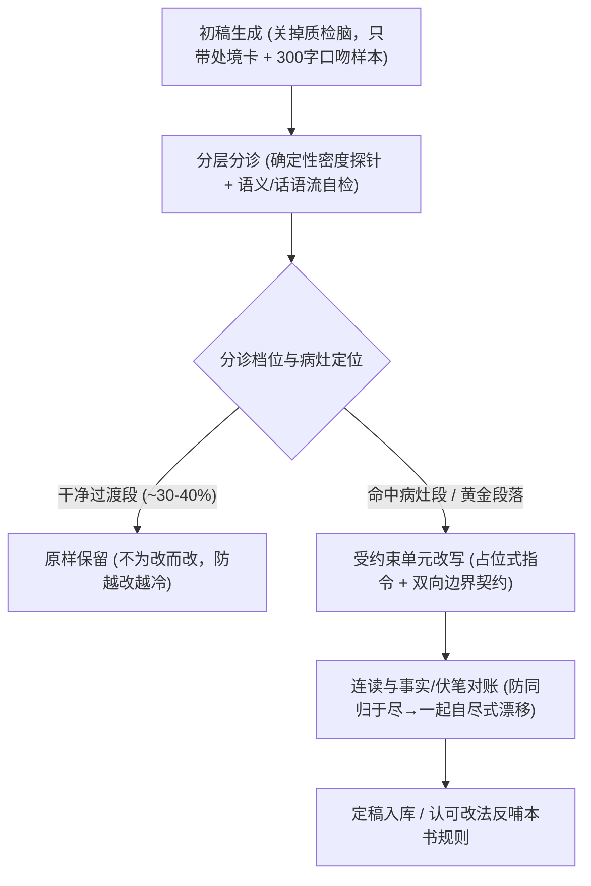

# 跨生态调研：现代 Agent Harness 与网文工业化流水线是怎么做「文字润色与去 AI 味」的？

2026-11-27。上一份记录拆解了酒馆生态里的 [Veridis Rewrite](./veridis-rewrite-reading.md)。这一份跳出酒馆封闭生态，对照 **2025–2026 年主流 Agent Harness 写作/去 AI 味工具链** 与 **国内高度工业化的长篇网文生产流水线**，看看外部世界是如何处理文字润色的，以及哪些经验能借、哪些因为场景本质不同而明确不借。

> [!IMPORTANT]
> **核心观察：「用正则字符串替换（`A → B`）直接改写正文」彻头彻尾是酒馆（SillyTavern）形态下的路径依赖产物。**
> 在本次调研覆盖的 8 套现代 Agent 写作/去味框架与 7 套国内网文工业化工作流中，**没有任何一家用正则替换去直接修改正文**。正则在现代体系里已退居为「零成本探针 / 密度计分器」，真正的改写建立在语义重构与声音语境之上。

---

## 0. 为什么酒馆会演化出「正则改写」，而外部世界早已抛弃它？

在酒馆里，玩家没有独立的回合阶段控制权，提示词糊成一锅大杂烩；外挂调第二次模型既慢又容易和 MVU/数据库插件打架，且裸调模型没有角色声线锚点，一改就变成平庸的「二次 AI 腔」。被逼无奈之下，酒馆老玩家才会退回到最安全的「正则删词/换词 + 窄句拼接」。

而外部两个生态早就证明了为什么**纯正则同义词替换治标不治本**：

- 在现代 Agent 写作技能 [Better Writing](https://github.com/forjd/better-writing) 中明确指出：「同义词替换会原封不动留下读者真正反感的句式节奏与骨架（A synonym swap leaves the rhythm and shape that readers notice）」。
- 在中文网文工业化工作流 [ximen-aimazi](https://github.com/ximencuisu/ximen-aimazi) 与 [马良写作 10 本首章实测（2026-11）](https://maliangwriter.com/blog/ai-web-novel-template-voice-fix/) 中得出完全一致的结论：「只洗禁语表等于给同一副骨架换皮；把『眼底精光暴涨』换成别的眼神词依然空泛。」

---

## 1. 现代 Agent Harness（2025–2026）是怎么考虑文字润色的？

调研样本包括：Claude Code / Codex / Cursor / Hermes 生态主流去味与编辑套件——[blader/humanizer](https://github.com/blader/humanizer)（基于维基百科 1.5 万字 *Signs of AI writing* 归纳 26 类模式，盲测 16:0 胜原稿）、[forjd/better-writing](https://github.com/forjd/better-writing)、[SalZaki/antislop](https://github.com/SalZaki/antislop)、[ccf/humanize](https://github.com/ccf/humanize)（基于 2026 年 61,575 篇故事语料研究 *StoryScope* 基线率）、[kimhons/humanize](https://github.com/kimhons/humanize)、古典编辑流派引擎 [Pilcrow](https://pilcrow.ink/)、Nous Research 的 [Hermes Creative Humanizer](https://hermes-agent.nousresearch.com/docs/user-guide/skills/bundled/creative/creative-humanizer)，以及学术界关于可执行编辑与重写管线的代表研究 [Can AI writing be salvaged? (LAMP)](https://arxiv.org/html/2409.14509)、[Beyond the Chat: InkSync (UIST '24)](https://people.ischool.berkeley.edu/~hearst/papers/laban_uist_2024.pdf) 与 [AI-Slop to AI-Polish? (2025)](https://arxiv.org/html/2504.07532v3)。

它们在 2026 年收敛出了三个高度一致的工程原则：

### 1.1 确定性代码只做「探针与成簇分诊（Detector）」，绝不直接改字

几乎所有成熟的 Agent 去味框架都配有一个零依赖脚本（如 [antislop](https://github.com/SalZaki/antislop) 的 `slop_count.py`、[kimhons/humanize](https://github.com/kimhons/humanize) 的 `humanize_score.py`、[Pilcrow](https://pilcrow.ink/) 的 `pilcrow audit`），但**它们一律是 Detection-Only**：

- **分层触发与「成簇阈值（Co-occurrence Threshold）」**：[blader/humanizer](https://github.com/blader/humanizer)、[better-writing](https://github.com/forjd/better-writing) 与 [antislop](https://github.com/SalZaki/antislop) 全部区分了「强特征（On-sight，如 `Not X, but Y`、助手客套尾巴，见一次改一次）」与「弱特征（Weak alone，如破折号、单个高频词、让步副词）」。`antislop` 的 `shared/spec.md` 硬性规定：**同一自然段内出现 ≥2 个任意类别痕迹，或 ≥3 个高频表词汇时，才强制触发重写**——因为孤立出现一次很可能是作者有意的修辞，盲目见词就杀只会毁掉好句子。
- **语体豁免（Genre Profiles & Allow-lists）**：[kimhons/humanize](https://github.com/kimhons/humanize) 与 [better-writing](https://github.com/forjd/better-writing) 均内置语体档位（小说、对话、技术文档、邮件），同一破折号或被动句在一种语体里是病灶，在另一种里完全合法。

### 1.2 「磨平（Flatness）本身就是最大的 AI 味」：靠具体文本校准声音，而非靠抽象形容词

这是 2026 年编辑类 Agent 最重要的共识。`better-writing` 的声音校准文档（`references/voice-and-context.md`）援引了 2026 年 *Nature Human Behaviour* 的实证研究：**未经声音锚定的 LLM 润色会把不同作者之间的风格差异压缩 21%–50%**，把所有文章打磨成同一种「顺滑、自信、略带塑料感的通用编辑腔」（[Claude Code for Writers](https://ccforeveryone.com/guides/claude-code-for-writers) 记录了让模型「精简一段话」，结果模型把句长全部拉平、还把段子里唯一的冷笑话改成了笑话摘要的典型翻车）。

现代 Harness 的解法高度统一：

- **用 300–500 字真实文本样本（Voice Sample / `VOICE.md`）取代抽象风格词**：[Hermes Humanizer](https://hermes-agent.nousresearch.com/docs/user-guide/skills/bundled/creative/creative-humanizer)、[blader/humanizer](https://github.com/blader/humanizer)、[Pilcrow](https://pilcrow.ink/) 全部以一段具体的参考文本作为声音真值源（句长分布、起句方式、标点习惯、保留口癖），而不是写「请用自然生动的文笔」。

### 1.3 诊断（Audit）与动刀（Rewrite）分离，严禁捏造事实

- **先诊断定位，再受控修改**：[Margin & Method](https://editorial.ai/ai-editing-workflow)、[Can AI writing be salvaged?](https://arxiv.org/html/2409.14509) 与 [AI-Slop to AI-Polish?](https://arxiv.org/html/2504.07532v3) 全部采用 `Identify problematic spans → Propose remedy → Execute bounded edit` 链路，而不是扔给模型一句模糊的「帮我润色得有人味一点」。
- **审计清单与改写指令隔离**：`better-writing` 的 `SKILL.md` 明确写道：「The ban lists in `references/` are for the audit, not for the rewrite.」
- **严禁为追求具体感而捏造事实（Specificity without Invention）**：[better-writing](https://github.com/forjd/better-writing)、[blader/humanizer](https://github.com/blader/humanizer) 与 [InkSync](https://people.ischool.berkeley.edu/~hearst/papers/laban_uist_2024.pdf) 均将「不新增原稿未支撑的事实、不篡改程度词、不硬塞错别字或俚语假装人类」列为最高护栏。

---

## 2. 国内长篇网文工业化工作流是怎么做高频润色的？

国内长篇网文（日更 4,000–20,000 字、连载数百章）是对中文叙事去 AI 味打磨最产业化的试验场。本次拆读了商业平台 [马良写作（MaliangWriter）2026 年 3 月与 11 月实测报告](https://maliangwriter.com/blog/ai-web-novel-template-voice-fix/)（刚用 **Gemini 4 Carbon** 与 **Gemini 4 Argon** 跑完 10 本首章盲测与自动去 AI 味实测），以及 GitHub 上代表性的开源网文 Agent 系统：[EdenBush/J-Novel](https://github.com/EdenBush/J-Novel)（`v7.7`–`v11.0`）、[阿序 axu-novel 5.0](https://github.com/asass-11/axu-novel)（2026-11）、[ximencuisu/ximen-aimazi](https://github.com/ximencuisu/ximen-aimazi)（`v2.6`）、[TulanCN/vibe-noveling](https://github.com/TulanCN/vibe-noveling)、[ExplosiveCoderflome/ani-book-skill](https://github.com/ExplosiveCoderflome/ani-book-skill) 与 [miserylee/webnovel-handbook](https://github.com/miserylee/webnovel-handbook/blob/main/docs/feedback-revision/08-review-and-reader-feedback.md)。

### 2.1 网文的「AI 味」三层结构：主战场在话语流与解释赘余

`ximen-aimazi`、`J-Novel`（`references/guides/rewrite-units.md`）与 `axu-novel`（`references/去AI味.md`）指出，真正让读者出戏的 AI 味往往单句没有语病，而集中在段落组织上：

1. **「每句都在干活，没有一句闲笔」**：6 句话全部 8–13 字推进动作（放行李 → 看屋子 → 拉抽屉 → 翻账本），像监控探头汇报。
2. **「旁白双倍解释 / 替读者总结陈词」**：角色动作或台词已经把情绪演出来了，旁白非要再补一句点破潜台词或段末升华句。**删掉那句多余的旁白解释，性价比远高于换词**。
3. **「资料问答式对白与摆姿势台词」**：所有人说话一个腔调、对答如流像开会，缺少停顿、回避或半截话。
4. **「流水线模板意象与落笔公式」**：宽肩窄腰冷白锁骨、眼底精光暴涨、放归山林的猎豹、「真正的风暴才刚开始」。

### 2.2 为什么不能无脑「整章全量重写」？马良写作的实测铁证与 30/40/30 法则

[马良写作 2026-11-11 的实测](https://maliangwriter.com/blog/ai-web-novel-template-voice-fix/) 拿 Gemini 4 Carbon 写的 3,133 字玄幻首章跑了一次站内「轻度档自动去 AI 味改写」，暴露出全篇无差别改写的两个致命伤：

1. **把原本鲜活具体的描写改平庸了**：原稿「后脊背一阵钻心剧痛……嗓子眼就像吞了一把生锈的碎铁渣」，被润色模型改成了笼统白开水「后背疼痛难忍……喉咙里好像被生锈的铁屑塞住了」，连古风的「木榻」都被洗成了现代「木床」。
2. **悄无声息篡改关键事实与词义**：原稿「拉着黑心庄家一块儿同归于尽」被改成了「一起自尽」；原稿「连亲叔父端来的毒酒都不防（没防备）」被改成了意思完全相反的「防不胜防」。

因此，国内网文工作流一致拒绝「整篇盲洗」：

- **30 / 40 / 30 火力分配（[马良写作修改指南](https://maliangwriter.com/blog/ai-novel-editing-polishing-guide)）**：一章里 30% 必精修、40% 命中病灶才动、30% 功能过渡段完全不动。
- **「不要动的」白名单（`axu-novel` 总结）**：人物贴着处境的具体心里话、对白里的口语语气词、正常的网文连接词与对白标签、已经贴切有力的细节描写——「《师姐》试写时一次删了二十二处心里话，读着反而更冷、更像 AI，后来全改了回去。拿不准就留。」

### 2.3 J-Novel 的两项工程设计：「占位式改写」与「双向边界契约」

在 [EdenBush/J-Novel](https://github.com/EdenBush/J-Novel) 的设计文档里，有两条经验值得记录：

1. **占位式改写（`occupancy-rewrite.md`）**：写初稿时关掉质检脑（不塞长串禁词表，只给声音样本）；写后先扫描定位病灶，进入改写时尽量避免向模型反复念黑名单原词（念一遍等于激活一次 n-gram），而是给出正向动作许可。
2. **双向边界契约（`rewrite-units.md`）**：「允许动什么」和「不许动什么」必须成对声明。如果只写「不许动什么」（如我们目前 `request.ts` `POLISH` 里要求保原长、禁删减），模型不知道动的额度有多大，遇到注水句只能生硬换同义词。

---

## 3. 收束回 Effect Tavern：为什么我们最终不照搬网文重工作流？（2026-11-27 讨论结论）

对比完外部生态后，我们在后续讨论中做了一次关键的**降温与边界切割**（落地为 **Issue #267** 与 **Issue #268**）：

### 3.1 AI 写作本质是语文问题，且 Tavern RP 与长篇网文的场景预算截然不同

1. **均值语种与模型禀赋**：在模型能力跨过真正的奇点之前，de-slop 与 humanizer 没有银弹。大模型学到的是人类语料的大杂烩均值，而真正有人味的文学恰恰极大偏离均值。就当前模型口味而言，Claude 虽强但文风极度冷静抽离（像观测者写人），ChatGPT 充满科技汇报/rebuttal 味，唯有 Gemini 系（2.5/3 Pro 到 Gemini 4 系列，尤其编程味较轻的 Argon）真正能把握情感——尽管它的八股常表现为极端浓烈或矫揉造作的情绪，但这种弱点反而更贴近人的认知。
2. **时效性与 60 分水位**：网文工作流要的是静态发表成品（从 50 分磨到 80 分），可以容忍多阶段审校和长耗时；但 **Tavern RP 要的是即时的情感满足与刺激玩家继续下一轮的 emotional hook**。在 `lookup → decide → direct → narrate → check → polish → record` 串行链路下，Polish 绝不能耗费与正文相当的时间做二稿重构——把 50 分的高频套路腔快速拉到 **60 分顺畅线**就够了。如果要做独立的重度润色引擎，应单独开新项目，绝不是塞进当前回合链路。

### 3.2 纯负向压制 vs 正向范文分离（「错误的写法有限，正确的写法无限」）

1. **不搞 `Before → After` 改写对与动态抽样**：像 [card-reading.md](./card-reading.md) §2.3 里的「·灰色と青」那样，好文字的可能性是无限的（life is immense, and language is immense）。如果在 Polish 里塞几组固定改写套路或搞复杂的跨场景抽样，只会制造新的句式与意象过拟合。
2. **职责彻底正交（落地为 #267）**：
   - **Polish 只做纯粹的负向压制**：保留「正则/通配快筛 + 命中时单次轻量语义微调」的极简形式，解开现行 `POLISH` 与 `splice()` 过度死板的保原长/禁删减束缚（守住完整句/句群边界），并向 `polish` 透传当前生效的 `<writing_guidelines>` 防止无头盲改。
   - **正向审美归属写作包**：直接挑选纯粹的「优美的中文」原文片段（不经人或 AI 二次演绎成抽象写作原则）放入写作包，通过挂载或开关来贴近品味。
3. **写作包双原语回归 Harness 中立（落地为 #268）**：
   - 写作包里的 `fragments`（静态常驻占位，plain information）与 `entries`（按需渐进揭示，progressive reveal information / Skill）本身分工合理，都是内容中立的信息揭示原语；问题在于现有代码在 `worldOf`、`LOOKUP`、`request.ts` 等处替用户做了过度的语义预设与硬隔离，后续应通过做减法去预设（而非特事特办造跨边界联动协议）把两者打通。

---

## 参考资料

- [Choosing anti-slop skills for writing and code](https://flaviocopes.com/anti-slop) (Sep 2026)
- [GitHub - blader/humanizer: Agent skill that removes signs of AI-generated writing from text](https://github.com/blader/humanizer) (Jan 2026)
- [Humanizer Skill: Make AI Text Sound Human](https://humanizerskill.com/) (2026)
- [GitHub - forjd/better-writing: An agent skill for prose that sounds clear, specific, and human](https://github.com/forjd/better-writing) (May 2026)
- [GitHub - SalZaki/antislop: Claude Code plugin with skills for removing AI-generated tells from writing](https://github.com/SalZaki/antislop) (2026)
- [GitHub - ccf/humanize: Remove AI tells from your writing — Grounded in academic research](https://github.com/ccf/humanize) (Sep 2026)
- [GitHub - kimhons/humanize: Anti-slop framework for Claude Code](https://github.com/kimhons/humanize) (Apr 2026)
- [Humanizer — Hermes Agent Documentation](https://hermes-agent.nousresearch.com/docs/user-guide/skills/bundled/creative/creative-humanizer) (2026)
- [Pilcrow: make your clanker your editor](https://pilcrow.ink/) (2026)
- [Claude Code for Writers: Drafts, Edits, and Your Voice](https://ccforeveryone.com/guides/claude-code-for-writers) (Jun 2026)
- [AI research-to-draft pipeline: why a prompt rule isn't enough](https://www.thedaringcreatives.com/ai-research-to-draft-pipeline) (Jun 2026)
- [AI Editing Workflow: A Human-in-the-Loop System — Margin & Method](https://editorial.ai/ai-editing-workflow) (Jul 2026)
- [Can AI writing be salvaged? Mitigating Idiosyncrasies and Improving Human-AI Alignment in the Writing Process through Edits](https://arxiv.org/html/2409.14509) (2024)
- [Beyond the Chat: Executable and Verifiable Text-Editing with LLMs (InkSync, UIST '24)](https://people.ischool.berkeley.edu/~hearst/papers/laban_uist_2024.pdf) (Jul 2024)
- [AI-Slop to AI-Polish? Aligning Language Models through Edit-Based Writing Rewards and Test-time Computation](https://arxiv.org/html/2504.07532v3) (Aug 2025)
- [AI写网文的模板味怎么改？10本AI网文首章里的6类模板句和改法 | 马良写作博客](https://maliangwriter.com/blog/ai-web-novel-template-voice-fix/) (Nov 2026)
- [AI小说修改与润色：从「能看」到「好看」的关键一步 | 马良写作博客](https://maliangwriter.com/blog/ai-novel-editing-polishing-guide) (Mar 2026)
- [GitHub - EdenBush/J-Novel: AI 小说创作的操作系统：从概念到完稿的端到端工业化流水线](https://github.com/EdenBush/J-Novel) (Oct 2026)
- [GitHub - asass-11/axu-novel: 阿序AI 长篇小说工作流 5.0](https://github.com/asass-11/axu-novel) (Nov 2026)
- [GitHub - ximencuisu/ximen-aimazi: 小说创作助手（十步流程+去AI味）](https://github.com/ximencuisu/ximen-aimazi) (Jun 2026)
- [GitHub - TulanCN/vibe-noveling: Claude Code Skills for Chinese web novel writing workflow](https://github.com/TulanCN/vibe-noveling) (May 2026)
- [GitHub - ExplosiveCoderflome/ani-book-skill: 面向 Codex 的长篇中文小说生产 Skill](https://github.com/ExplosiveCoderflome/ani-book-skill) (Jul 2026)
- [GitHub - miserylee/webnovel-handbook: 08-review-and-reader-feedback.md](https://github.com/miserylee/webnovel-handbook/blob/main/docs/feedback-revision/08-review-and-reader-feedback.md) (2026)
