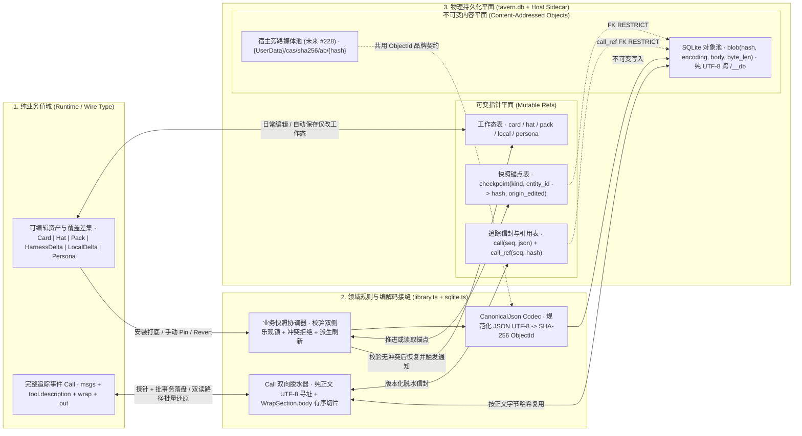
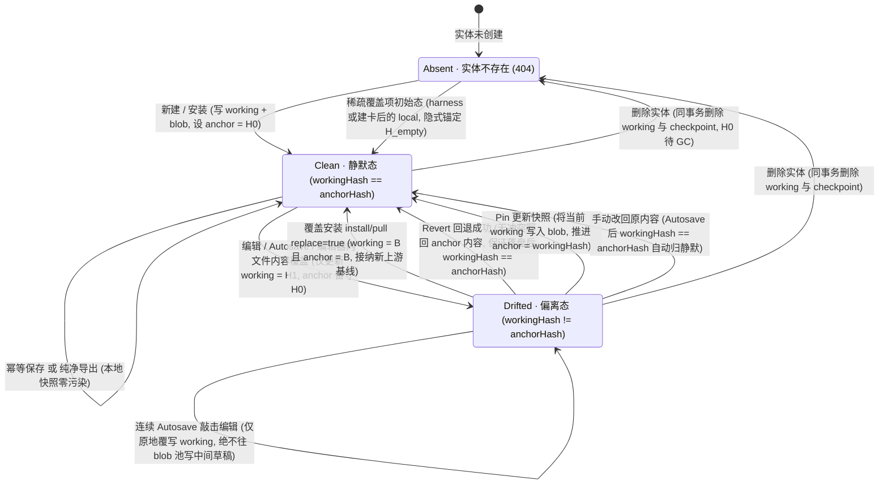
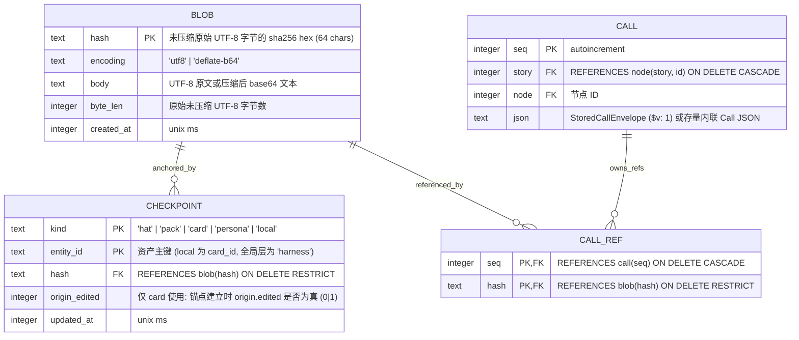

# 存储演进与通用单层快照 · SDD 设计定稿（#238）

承接 [#238](https://github.com/piepiaspace/effect-tavern/issues/238)。本文从第一性原理与 **SDD（Schema-Driven Development）** 出发，结合现有代码接缝、`effect@4.1.4` 的 `Schema` 契约模型及评审收敛结论，定稿底层内容寻址对象池（CAS）、通用单层快照状态机（Universal Single-Checkpoint + 可达性 GC）与长期聊天 `call` 追踪去重的架构蓝本。

---

## 一、代码走查与架构收敛的四个物理边界

在设计 Schema 之前，现有代码与开发库实测明确了四个直接决定架构边界的硬约束：

1. **Desktop / Android 的 `/__db` 同步 JSON 桥接约束（读写双向常数复杂度）**
   在 [`packages/app/db.go`](../packages/app/db.go#L79-L142)、[`packages/app/web/sqlite.ts`](../packages/app/web/sqlite.ts#L5-L50) 与 [`packages/app/web/bundle.ts`](../packages/app/web/bundle.ts#L18-L20) 中，独立端将 `@effect-tavern/server` 打包在 WebView 主线程运行，通过同步 `XMLHttpRequest` + JSON 调用 Go 侧单连接 SQLite：
   - **地址与载荷解耦，禁止裸二进制跨桥**：**对象地址 `ObjectId` 严格由未压缩的原始 UTF-8 内容字节（`SHA-256`）决定**，调整压缩方式或传输编码绝不改变任何快照与追踪引用。由于 `db.go` 会将 `[]byte` 强转为 `string(b)` 后再走 JSON 编码（非法 UTF-8 会被静默替换为 `\uFFFD`），且 `tavern.db` 要求在 CLI（`bun:sqlite`）与移动端（`modernc.org/sqlite`）之间单文件直接互拷通用，SQLite `blob` 表统一采用纯 UTF-8 安全文本载荷（`"utf8" | "deflate-b64"`）。
   - **业务逻辑集中在 TypeScript，Go 仅提供零业务语义的通用批事务**：不仅读路径（`calls.get` / `calls.list`）必须收敛为 **≤ 2 条集合 SQL**，写路径 `calls.add` 也绝不能按消息或引用边逐条 `.run()` 跨桥。`db.go` 与 `web/sqlite.ts` 仅新增零业务耦合的通用批执行模式（`mode: "batch"`）；`sqlite.ts` 写路径采用**「先单次探测库内已有哈希，再在单次批事务内写入新增 `blob` 正文、轻量 `call` 信封、全部 `call_ref` 引用边并执行窗口裁剪」**——跨桥往返次数为常数级（无并发回收时冷缓存 ≤ 2 次，与历史消息数无关），命中已有哈希的历史正文无需重复跨桥传输。内存已知哈希集合仅作热路径优化，必须在 GC 后失效并在外键约束报错时自动回退补写。

2. **Tool Wrap（`#220`）与普通消息同址去重，按有序原文片段无损还原**
   - **落盘现状**：[`packages/runtime/src/session.ts`](../packages/runtime/src/session.ts#L224-L230) 在组装 `Call` 事件时已剥离中间态 `wrap.messages` 与 `rawText`，落盘的 `Call.wrap` 仅含轻量 `WrapTrace`（`traces`、`sections`、`context`），不存在 `wrap.messages` 双存。
   - **有序切片覆盖全区间**：[`packages/runtime/src/request.ts`](../packages/runtime/src/request.ts#L623-L638) 在相邻 `<message>` 之间插入 `\n\n`（落在两个 `WrapSection` 之外），且支持自定义模板前后缀。脱水时不假设任何固定分隔符，而是沿 `WrapSection.body` 的 JS 字符串偏移（UTF-16 code unit 边界）将 `tool.description` 切为**覆盖 `[0, description.length)` 全长的有序原文片段 `Array<string | TextBlobRef>`**，切完再编码为 UTF-8 字节入池，区间外所有原文原样保留，读取时直接顺序拼接还原。
   - **跨阶段同址复用**：普通文本消息的 `msgs[i].content`、`out` 中的长文本（含 `lookup` / `record` 原生工具阶段 `StageStep.messages` 中的消息正文）以及 `WrapSection.body` 均对**纯正文的原始 UTF-8 字节**取 SHA-256（外层保留 `{ role, providerOptions, ... }` 等消息结构骨架；短于最小阈值如 `128 B` 或含孤立代理项的字符串保持内联）。这样即使历史消息上的缓存断点 `providerOptions` 随轮次后移，或消息在普通阶段与 Tool Wrap 阶段之间切换，依然 100% 命中同一个 `ObjectId`。

3. **开发库实测体积结构与 `auto_vacuum = INCREMENTAL`**
   - 开发库样本（8 个故事、29 个 `node`、65 条 `call`）显示：全部可编辑资产（`card` + `hat` + `pack` + `local` + `persona`）合计 **46.6 KB**，`node` 表 **170.9 KB**，而 `call` 表达 **562.4 KB**（`msgs` **276 KB**、`out` **278 KB**）。短对话样本仅对 `msgs` 做静态消息级去重约为 `3.04×`；整库实际收益、长故事每新增一轮的物理增量与主线程耗时留待实测基准验证。
   - 存量库当前 `PRAGMA auto_vacuum = 0`（`NONE`）。新库建表前直接启用 `PRAGMA auto_vacuum = INCREMENTAL`；存量库在迁移初始化或 `tavern doctor` 清理时配合一次 `VACUUM` 激活增量回收页头，日常 GC 仅按页数预算执行 `PRAGMA incremental_vacuum(pages)` 渐进归还空闲页。

4. **稀疏默认覆盖、工坊乐观锁与上游 `origin.edited` 的正交边界**
   - **稀疏覆盖资产（`harness` 与 `local`）**：[`packages/server/src/library.ts`](../packages/server/src/library.ts#L589-L599) 中 `pack` 表的 `harness` 行与有效角色卡下的 `local` 行仅代表**相对默认值的用户覆盖差集（Overlay Delta）**。“无覆盖”本身即为合法的天然初始基线（规范化为空对象 `"{}"`，对应共享哈希 `H_empty`，按需物化入 `blob`），与“所属角色卡已删除（`404 no-card`）”严格区分；回退到 `H_empty` 即清除覆盖、继续跟随当前内置或卡片默认值，绝不将当时的合并展示态固化为死配置。
   - **本地快照状态与上游来源状态正交**：`CheckpointStanding`（`clean | drifted`）表达“当前工作态相对用户上次认可的本地快照是否偏离”；角色卡的 [`Origin.edited`](../packages/runtime/src/library.ts#L23-L29) 表达“本地卡片相对上游安装来源（如卡库版本）是否改过”。玩家在工坊改卡后点 `Pin`，相对快照变为 `clean`，相对上游卡库依然是 `edited: true`。

> [!IMPORTANT]
> **共同底座、独立写规则的设计原则**
> 资产快照（Layer 3）与聊天追踪（Layer 2）共用同一个不可变对象池（Layer 1：只回答“这段字节存过吗、还有谁引用它”），但各自拥有独立的领域写入契约：编辑器关心**“用户认可并随时能精确退回哪一版”**，Inspector 关心**“当时究竟向模型发了什么、回了什么”**。

---

## 二、Schema 全景流转图（三平面模型）



---

## 三、状态流转与协议不变量（State Machines & Invariants）

### 3.1 Layer 3 · 通用单层快照状态机（业务语义驱动，无 `Unanchored` 态）

存量库升级迁移时一次性为既有可编辑资产建立初始锚点，新建/安装时同步建锚，`harness` 与现存卡的 `local` 天然以无覆盖 `H_empty` 为初始锚点。因此任何现存可编辑实体的 `(workingHash: ObjectId, anchorHash: ObjectId)` 均为非空总函数，产品状态机直接化简为 **`Clean` / `Drifted` 二态投影**（不落盘冗余布尔脏标志）：



#### 五类可编辑资产的业务规则与硬不变量

1. **按业务操作定锚点（UI、CLI、服务端调用统一语义）**：
   - **安装或覆盖安装（`create`、`cards.install` 含 `replace: true`、`importLink`、`depots.pull`、`hats/packs` 新建或生成新 ID 的文件导入）**：将落盘版本同时设为工作态与锚点（`Clean`）。玩家在书架将卡片从 `v1.0` 一路更新至 `v1.3` 后进工坊微调改坏，点「回退」即精确回到 `v1.3`。
   - **编辑与自动保存（工坊 `save`、`hats/packs/personas/locals` 编辑写回，以及未来编辑器内「用文件内容覆盖当前编辑项」）**：只改工作态，不动锚点。
2. **硬不变量 · `Revert` 成功即保证 `Clean`（拒绝静默改写漂移）**：
   - 恢复资产必须经过领域校验并在提交后触发完整副作用，但**绝不允许静默篡改快照内容导致写回后哈希仍不等于 `anchorHash`**：
     - **`hat`**：校验 `normalizeHatDelivery` 与 `hatToolProblem`；若锚点中的 `hat.name` 已被另一顶不同 ID 的 Hat 占用，**不调用自动编号改名的 `uniqueHatName`**，而是拒绝恢复并返回 `409 checkpoint-conflict`（指明冲突名称），保留现场交由用户处理。
     - **`local`**：校验所属 `card` 存在；若锚点中的 `mounts` 含已删除的 `pack` ID，或 `persona` 指向已删除的 `persona` ID，**不静默剥离引用**，而是返回 `409 checkpoint-conflict`（列出缺失引用 ID）。回退到 `H_empty` 时删除 `local` 表物理行。
     - **`pack`**：普通包经 `decodeLayer` 校验写回；`harness` 仅快照 `overlayOf("act", r)` 差集，回退到 `H_empty` 时物理删除 `pack` 表中的 `'harness'` 行。
     - **`card`**：校验非 `builtin` 且通过 `validateCard`，写回卡片正文并重算 `summary` 与 `facets(card)`，按 `checkpoint.origin_edited` 恢复锚点当时的 `origin.edited` 位（改卡后 `Pin` 会记下 `origin_edited = 1`，故再改再回退仍保持相对上游 `edited: true`；而未 `Pin` 直接回退到干净安装基线则恢复 `origin_edited = 0`），事务提交后调用 `changed(card.id)` 刷新空闲缓存 `Session` 并返回最新 `rev`。
     - **`persona`**：快照仅含纯文本载荷 `{ id, name, text }`，回退时只恢复该三元组，绝不触碰全局默认标记表 `persona_default`。
3. **双侧乐观并发校验 `(expectedWorkingHash, expectedAnchorHash)`**：
   - `pin` 与 `revert` 均在同一数据库事务内校验客户端看到的当前 `workingHash` 与 `anchorHash`（卡片同时兼容校验 `rev`）：任一侧已被其他标签页改动（例如另一页刚自动保存了新内容，或刚点了一次 `Pin` 改变了回退目的地），立即拒绝并返回 `409 checkpoint-changed` 及最新状态，防止盲盖。

---

### 3.2 Layer 1 & 2 · `call` 常数跨桥脱水落盘、双路径批量还原与可达性 GC

```mermaid
flowchart TD
  subgraph WritePath["A. 回合落盘路径 (calls.add · 常数次跨桥)"]
    W1["收到节点追踪 Call[]"] --> W2["JS 侧结构化脱水 · 提取长文本与 WrapSection.body 正文 UTF-8 字节并算 SHA-256"]
    W2 --> W3["跨桥 1 · 单条 json_each 探测库内尚未存在的 ObjectId 差集"]
    W3 --> W4["跨桥 2 (单批事务) · 仅传输缺失 blob 正文批量 INSERT OR IGNORE"]
    W4 --> W5["同批事务 · INSERT INTO call 写入 $v:1 信封 + 批量登记 call_ref 引用边"]
    W5 --> W6["同批事务 · 滑动窗口裁剪旧节点 call (ON DELETE CASCADE 级联释放 call_ref)"]
  end

  subgraph ReadPath["B. 双读取路径 (calls.get 单节点 & calls.list 整故事)"]
    R1["SQL 1 · 按 (story, node) 或 (story) 有序读取 call 信封行"] --> R2["SQL 2 · JOIN call_ref 单条查询取回关联去重 blob 字典"]
    R2 --> R3["统一 Hydrator · 存量无 $v 行零开销直出 / $v:1 行还原 $text 与 $slices"]
    R3 --> R4["保证与落盘前 Call 完整 deepStrictEqual 且 tool.description 逐字符相等"]
  end

  subgraph GCPath["C. 可达性回收与渐进空间归还 (GC & Incremental Vacuum)"]
    G1["触发时机 · 删除故事 / 删除资产 / tavern doctor 维护"] --> G2["关系集合差清扫 · DELETE FROM blob WHERE NOT EXISTS checkpoint AND NOT EXISTS call_ref"]
    G2 --> G3["使内存已知哈希缓存失效 + PRAGMA incremental_vacuum(pages) 渐进归还空闲页"]
  end
```



---

## 四、SQLite 物理表与通用批桥接契约

### 4.1 SQLite 物理表关系图（ER Schema）



> [!WARNING]
> **数据库级外键不变量与双索引保证：**
> 1. `checkpoint.hash -> blob.hash` 与 `call_ref.hash -> blob.hash` 均声明 **`ON DELETE RESTRICT`**，并建立索引 `CREATE INDEX call_ref_hash ON call_ref(hash)` 与 `CREATE INDEX checkpoint_hash ON checkpoint(hash)`——不仅 SQLite 内核直接阻止误删任何仍被引用的 `blob`，且 GC 的 `NOT EXISTS` 反连接走纯索引扫描，无需全表扫 `call_ref`。
> 2. `call_ref.seq -> call.seq` 声明 **`ON DELETE CASCADE`**——删除故事、回滚分支节点或执行 `traced = 200` 滚动窗口裁剪时，引用边由 SQLite 自动级联释放。

### 4.2 `/__db` 宿主桥接最小通用扩展（`packages/app/db.go` & `web/sqlite.ts`）

不在 Go 层引入任何 `blob` / `call` / `checkpoint` 业务概念，仅在现有 `exec | run | rows` 之上增加一个原子批模式 `batch`：
- 请求载荷：`{ mode: "batch", steps: Array<{ sql: string, params?: Param[], mode: "exec" | "run" | "rows" }> }`；
- Go 执行语义：在 `dbMu` 锁定的单连接 `dbConn` 上显式开启 `BEGIN IMMEDIATE`，按序执行 `steps`，任一步报错立即 `ROLLBACK` 并返回错误状态码，全部成功则 `COMMIT` 并一次性返回结果数组；
- 适用范围：预先确定的 SQL 步骤可一次跨桥原子执行。若后续写入依赖 TypeScript 对查询结果的判断，需在批内用 SQL 前置条件验证此前读到的状态，校验失败则回滚。两条批量读取 SQL 同样需要共享一致的读快照。 `bun:sqlite` 与 WebView 共享 100% 同一份 `packages/server/src/sqlite.ts` 源码。

---

## 五、Effect v4 (`4.1.4`) 核心 Schema 与编解码原型

以下契约作为实现阶段 `packages/runtime/src/storage.ts`（跨前后端共享的状态与冲突契约）与 `packages/server/src/sqlite.ts`（CAS 与 `Call` 双向编解码器）的直接基准：

```typescript
import { sha256 } from "@noble/hashes/sha2.js"
import { bytesToHex, utf8ToBytes } from "@noble/hashes/utils.js"
import { Schema } from "effect"

// ─── 1. 内容寻址原语 (地址仅取决于未压缩原始 UTF-8 字节) ─────────────────────

/** 64 位小写 hex SHA-256 内容地址（SQLite blob 表与未来 #228 宿主旁路媒体 CAS 共用） */
export const ObjectId = Schema.String.check(Schema.isPattern(/^[0-9a-f]{64}$/)).pipe(Schema.brand("ObjectId"))
export type ObjectId = typeof ObjectId.Type

export const BlobEncoding = Schema.Literals(["utf8", "deflate-b64"])
export type BlobEncoding = typeof BlobEncoding.Type

/** 递归按 UTF-16 码元序排列普通对象键，消除键序差异造成的资产哈希漂移 */
export const canonicalJson = (value: Schema.Json): string => {
  if (Array.isArray(value)) return "[" + value.map(canonicalJson).join(",") + "]"
  if (value === null || typeof value !== "object") return JSON.stringify(value)
  const object = value as Schema.JsonObject
  return "{" + Object.keys(object).sort().map(k => JSON.stringify(k) + ":" + canonicalJson(object[k])).join(",") + "}"
}

export const hashUtf8 = (utf8: string): ObjectId => ObjectId.make(bytesToHex(sha256(utf8ToBytes(utf8))))

/** 稀疏覆盖项（harness / local）无任何用户覆盖时的天然基线对象地址 */
export const EMPTY_OVERLAY_JSON = "{}"
export const EMPTY_OVERLAY_HASH: ObjectId = hashUtf8(EMPTY_OVERLAY_JSON)

// ─── 2. Layer 3 · 通用单层快照状态、请求与冲突契约 ───────────────────────────

export const CheckpointKind = Schema.Literals(["hat", "pack", "card", "persona", "local"])
export type CheckpointKind = typeof CheckpointKind.Type

/** 二态快照投影（迁移一次性打底 + 稀疏项默认锚定 EMPTY_OVERLAY_HASH，无 Unanchored 态） */
export const CheckpointStanding = Schema.Union([
  Schema.Struct({
    status: Schema.Literal("clean"),
    hash: ObjectId,
    updatedAt: Schema.NullOr(Schema.Int), // 隐式锚定 EMPTY_OVERLAY_HASH 且尚未显式落行时为 null
  }),
  Schema.Struct({
    status: Schema.Literal("drifted"),
    workingHash: ObjectId,
    anchorHash: ObjectId,
    updatedAt: Schema.NullOr(Schema.Int),
  }),
])
export type CheckpointStanding = typeof CheckpointStanding.Type

export const deriveStanding = (
  workingHash: ObjectId,
  anchor: { hash: ObjectId; updatedAt: number | null },
): CheckpointStanding =>
  workingHash === anchor.hash
    ? { status: "clean", hash: anchor.hash, updatedAt: anchor.updatedAt }
    : { status: "drifted", workingHash, anchorHash: anchor.hash, updatedAt: anchor.updatedAt }

/** Pin 与 Revert 必须同时校验工作态与锚点双侧版本，防止跨标签页并发盲盖或回退目标漂移 */
export const CheckpointMutation = Schema.Struct({
  action: Schema.Literals(["pin", "revert"]),
  expectedWorkingHash: ObjectId,
  expectedAnchorHash: ObjectId,
  rev: Schema.optionalKey(Schema.String), // card 工坊额外透传当前 rev 对齐既有乐观锁
})
export type CheckpointMutation = typeof CheckpointMutation.Type

/** Revert 遇到外部环境冲突时拒绝静默改写，返回结构化冲突原因供前端明确提示 */
export const CheckpointConflict = Schema.Union([
  Schema.Struct({
    reason: Schema.Literal("hat-name-taken"),
    name: Schema.String,
    takenByHatId: Schema.String,
  }),
  Schema.Struct({
    reason: Schema.Literal("missing-references"),
    missingPacks: Schema.Array(Schema.String),
    missingPersona: Schema.NullOr(Schema.String),
  }),
])
export type CheckpointConflict = typeof CheckpointConflict.Type

// ─── 3. Layer 2 · Call 无损双射脱水信封契约（跨普通消息、Wrap 与 out 同址复用） ─

/** 最小入池字节阈值：短文本保留内联，避免 64 字符哈希引用与索引行反超原文体积 */
export const MIN_BLOB_BYTES = 128

/** 指向 blob 表中纯 UTF-8 文本正文的引用 */
export const TextBlobRef = Schema.Struct({ $text: ObjectId })
export type TextBlobRef = typeof TextBlobRef.Type

/** Tool Wrap 下 tool.description 的全区间有序原文片段（精确还原相邻 \n\n 与自定义模板文案） */
export const TextSlicesEnvelope = Schema.Struct({
  $slices: Schema.Array(Schema.Union([Schema.String, TextBlobRef])),
})
export type TextSlicesEnvelope = typeof TextSlicesEnvelope.Type

/** 转义信封：当任意原始业务对象本身恰好含有 $text / $slices / $esc 键时原样包裹，保证全值域双射 */
export const EscapedObjectEnvelope = Schema.Struct({
  $esc: Schema.Record(Schema.String, Schema.Unknown),
})

/** 顶层版本化信封：与存量无 $v 键的内联 Call (`kind: "call"`) 在顶层严格互斥，零迁移兼容旧行 */
export const StoredCallV1 = Schema.Struct({
  $v: Schema.Literal(1),
  call: Schema.Unknown,
})
export type StoredCallV1 = typeof StoredCallV1.Type
```

#### `tool.description` 按 `WrapSection.body` 切片与全结构双射准则

1. **切片规则（`sliceWrappedDescription`）**：
   - 给定 `description: string` 与按偏移升序排列的 `wrap.sections: readonly WrapSection[]`：
   - 维护游标 `cursor = 0`，依次遍历每个 `sec.body`（满足 `cursor <= sec.body.start <= sec.body.end <= description.length`）：
     - 若 `sec.body.start > cursor`，推入区间外原文片段 `description.slice(cursor, sec.body.start)`（涵括模板前缀、`<message role="…">\n`、`</message>\n\n` 等一切原文）；
     - 推入消息正文片段 `description.slice(sec.body.start, sec.body.end)`；
     - 更新 `cursor = sec.body.end`；
   - 循环结束后若 `cursor < description.length`，推入尾部片段 `description.slice(cursor)`（涵括末尾 `</message>` 与模板后缀）。
   - 对每个片段：仅当 `segment.isWellFormed()` 且 `utf8ToBytes(segment).byteLength >= MIN_BLOB_BYTES` 时登记为 `{ $text: hashUtf8(segment) }`，否则保留原字符串。还原时将每个元素映射回字符串后 `.join("")`，即可逐码元精确复原 `description`。
2. **通用字段递归脱水（`msgs` / `out` / 其余字段）**：
   - 递归遍历 `Call` 的其余 JSON 值：凡满足 `s.isWellFormed()` 且 UTF-8 字节数 `>= MIN_BLOB_BYTES` 的字符串，统一替换为 `{ $text: hashUtf8(s) }`；凡自身含有 `$text` / `$slices` / `$esc` 自有属性的对象，包裹为 `{ $esc: ... }`。
   - 由此，`msgs[i].content`（纯文本消息）、`msgs[i].content[k].text`（多段推理/正文）、`out`（`narrate` 正文或 `lookup` / `record` 阶段 `StageStep.messages` 中的历史消息）以及 `WrapSection.body` 全部汇聚到同一套纯正文 UTF-8 `ObjectId` 上，且还原后满足严格结构相等。

---

## 六、模块接缝与多宿主落盘边界

| 维度 | 浅补丁做法（避免） | SDD 深模块做法（定稿采纳） |
| :--- | :--- | :--- |
| **快照职责划分** | 在五张业务表各加备份列，或让底层存储绕过业务规则盲写覆盖 | `sqlite.ts` 管理不可变 `blob` 与 `checkpoint` 原子读写；`library.ts` / `shelf.ts` 掌管覆盖差集提取、冲突拒绝（重名/缺失引用 -> `409`）与恢复后的缓存/派生刷新 |
| **`call` 去重与跨桥** | 侵入 `runtime/session.ts`，或在 Go 宿主重写一套追踪去重逻辑 | **零 `runtime` 侵入、零 Go 业务耦合**：编解码封闭在 `sqlite.ts` `calls(story)` 内，`db.go` 仅加通用 `batch` 事务模式，探测 + 批量写入常数次跨桥 |
| **体积诊断（`tavern doctor`）** | 仅统计数据目录文件总字节数 | 只读 SQL 聚合输出：`call` 逻辑字节 vs `blob` 物理字节、不可达孤儿 `blob` 数与字节、SQLite `freelist_count` 空闲页占比与 `auto_vacuum` 模式 |
| **多宿主物理落盘约定** | 将大体积二进制媒体塞进 SQLite 阻塞移动端 `/__db` | **主库 `tavern.db`** 存结构化表与 UTF-8 安全文本 `blob`（CLI 与 Android 单文件直拷通用）；未来 `#228` 本地媒体缓存落 **`<UserData>/cas/sha256/<2-hex>/<hash>`** 旁路目录，共用 `ObjectId` 类型 |

---

## 七、已拍板的设计决议与硬验收条件（实施基线）

前期讨论与代码核对涉及的全部开放问题均已收敛闭合：

### 7.1 四项最终设计决议

1. **业务操作决定快照转移（采纳方案 A）**：新建、安装与同 ID 覆盖安装（`cards.install` / `importLink` / `depots.pull` 含 `replace: true`）同时设定工作态与锚点（`Clean`）；日常编辑、自动保存及未来编辑器内「用文件内容覆盖当前项」只改工作态；手动 `Pin` 推进锚点，`Revert` 恢复锚点。
2. **`Revert` 精确性承诺与双侧并发锁**：`Revert` 成功即保证落盘后 `workingHash === anchorHash`（`Clean`）；遇到 Hat 重名占用或 Local 缺失写作包/人设引用时拒绝静默改写，返回 `409 checkpoint-conflict` 保留现场。`Pin` 与 `Revert` 在单事务内同时校验 `expectedWorkingHash` 与 `expectedAnchorHash`。
3. **存量库一次性打底初始化（消除 `Unanchored`）**：`sqlite.ts` 升级步骤将库内现存 `hat`、普通 `pack`、`card`、`persona` 及已存在的 `harness` / `local` 覆盖行一次性写入 `blob` + `checkpoint`（卡片同步记录当时的 `origin.edited` 位）；无覆盖的 `harness` 与现存卡 `local` 天然锚定 `EMPTY_OVERLAY_HASH`。
4. **分期节奏与延迟启用压缩**：
   - **压缩策略**：一期 `blob` 表包含 `encoding` 列但仅写 `"utf8"`（零压缩耗时、100% 透明）；二期依据真实长故事体积测量决定是否对超阈值块启用 `"deflate-b64"`。
   - **Phase 1（Layer 1 + Layer 3 + 通用桥接批处理）**：落地 `blob` 与 `checkpoint` 表、迁移一次性打底、`/checkpoints/:kind/:id` 接口与五类可编辑资产业务接缝、`db.go` / `web/sqlite.ts` 通用 `batch` 模式、可达性 GC + `incremental_vacuum` 及 `tavern doctor` 存储诊断，接通编辑页快照顶栏。
   - **Phase 2（Layer 2 + 长故事基准测试）**：落地 `call` (`$v: 1`) + `call_ref` 正文级去重与 `WrapSection.body` 切片编解码，统一 `calls.get` / `calls.list` 批量还原路径，并产出长故事实测报告。

### 7.2 硬验收条件（Acceptance Invariants）

- **追踪读写逐字符无损（Round-trip Identity）**：构造包含中文、emoji（UTF-16 代理对）、多段推理/工具握手消息、`providerOptions` 缓存断点、自定义模板 `{{context}}` 的真实 `Call`，经 `calls.add` 写入后再分别由 `calls.get(node)` 与 `calls.list()` 读出，以现有落盘边界的 JSON 值（`JSON.parse(JSON.stringify(call))`）为 expected，两者均满足 `deepStrictEqual(actual, expected)`，`tool.description` 逐字符相等，Inspector 所有 `Span` 与 `WrapSection` 偏移无需重算原样精确指向原文。
- **跨桥常数复杂度与增量传输（Bridge O(1)）**：在 WebView `/__db` 垫片测试下，单轮 `calls.add` 跨桥请求次数不随历史消息轮数（如 10 轮 vs 150 轮）增长（无并发回收时冷缓存 ≤ 2 次请求），且库内已存在哈希对应的历史消息正文不出现在批写入载荷中。
- **快照精确回退与并发安全（Checkpoint Exactness）**：对五类资产覆盖验证「新建 -> 编辑偏离 -> 回退必为 `Clean`」「改卡 -> `Pin` -> 再改 -> 回退仍保留 `origin.edited: true`」「Hat 重名 / Local 删包后回退报 `409 checkpoint-conflict` 且现场未损」「跨页修改工作态或推进锚点后旧页 `Pin`/`Revert` 报 `409 checkpoint-changed`」。
- **外键防悬空与可达性回收（GC Safety）**：任一仍被 `checkpoint` 或未裁剪 `call_ref` 引用的 `blob` 物理不可删（`RESTRICT`）；删除故事、滚动裁剪超 200 节点追踪或删除资产后执行 GC，孤儿 `blob` 清零而存活快照与追踪读取 100% 正常。
