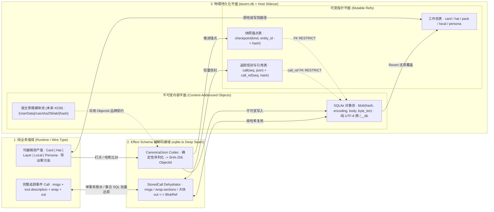
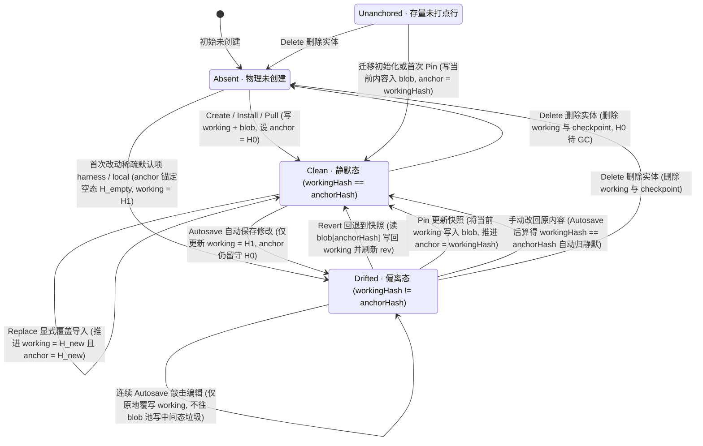
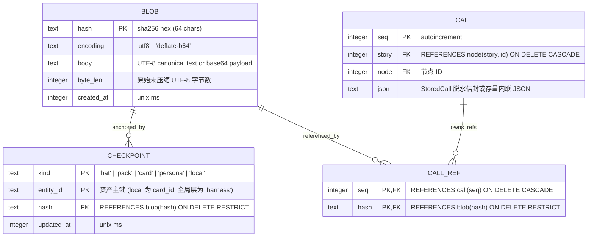

# 存储演进与通用单层快照 · SDD 设计原型（#238）

承接 [#238](https://github.com/piepiaspace/effect-tavern/issues/238)。本文从第一性原理与 **SDD（Schema-Driven Development）** 出发，结合现有代码接缝与 `effect@4.1.4` 的 `Schema` 双向编解码（`Codec<Type, Encoded>`）模型，给出底层内容寻址对象池（CAS）、文件系统状态流转机（通用单层快照 + 可达性 GC）及长期聊天 `call` 追踪去重的完整设计原型，并记录下次开工前待拍板的开放决策。

---

## 一、代码走查揭示的四个物理约束

在设计 Schema 之前，现有代码与开发库实测明确了四个直接决定架构边界的硬约束：

1. **Desktop / Android 的 `/__db` 同步 JSON 桥接约束**
   在 [`packages/app/db.go`](../packages/app/db.go#L127-L138) 与 [`packages/app/web/sqlite.ts`](../packages/app/web/sqlite.ts#L5-L36) 中，独立端 WebView 主线程通过**同步 `XMLHttpRequest` + JSON** 逐条执行 SQL：
   - **禁止裸二进制 `BLOB` 跨桥**：`web/sqlite.ts` 的 `Param` 仅支持标量而不支持 `Uint8Array`；`db.go` 将 `[]byte` 强转为 `string(b)` 后再走 `json.NewEncoder`——若直接在 SQLite 存裸 `zstd` / `gzip` 二进制字节，Go 编码 JSON 时会将非法 UTF-8 序列静默替换为 `\uFFFD`，直接损坏载荷。因此 SQLite 对象池必须采用纯 UTF-8 安全的文本编码契约（`"utf8" | "deflate-b64"`）。
   - **禁止主线程 N+1 逐哈希查询**：移动端每次 `db.query()` 都是一次跨进程同步 XHR。还原某节点的 `call` 追踪或批量计算快照状态，必须收敛为 **1～2 条集合 SQL（`IN` / `JOIN`）**。
2. **Tool Wrap（`#220`）天然携带 AST 切片边界，无需引入滑动窗口 CDC**
   [`packages/runtime/src/request.ts`](../packages/runtime/src/request.ts#L624-L639) 的 `wrapNarrate` 与 [`packages/runtime/src/trace.ts`](../packages/runtime/src/trace.ts#L167-L186) 的 `WrapTrace` 已经在 `call.wrap` 中精确记录了 `context: { start, end }` 与每段 `<message>` 的 `sections[i]: { start, end }`。脱水时直接按 `WrapTrace` 边界切分即可 100% 命中消息级对象池，还原时逐字节无损拼回，完全不需要 Rabin/Buzhash 等分块算法。
3. **开发库实测体积结构与 `auto_vacuum = 0`**
   实测开发库（8 个故事、29 个 `node`、65 条 `call`）：
   - 全部可编辑资产（`card` + `hat` + `pack` + `local` + `persona`）合计仅 **46.6 KB**；
   - `node` 表 **170.9 KB**，而 `call` 表已达 **562.4 KB**（其中 `msgs` 占 **276 KB**、`out` 占 **278 KB**）；仅在平均 3.6 轮的短对话中，消息级去重即可将 `msgs` 压至 **90.6 KB（3.04×）**，长对话前缀复用率将超过 95%；
   - 存量库 `PRAGMA auto_vacuum = 0`（`NONE`），裁剪旧 `call` 后的 freelist 页不会归还操作系统，升级迁移时需切换为 `INCREMENTAL` 并配合渐进回收。
4. **稀疏默认行与工坊既有乐观锁接缝**
   - [`packages/server/src/shelf.ts`](../packages/server/src/shelf.ts#L76) 已有基于存储内容摘要的 `rev`（`409 card-changed`），[`packages/client/src/workshop.tsx`](../packages/client/src/workshop.tsx#L56-L101) 围绕无草稿直写 + `rev` 运作；单层快照与无草稿直写正交——草稿挡在生效态**之前**，而快照锚定在生效态**之后**。
   - [`packages/server/src/library.ts`](../packages/server/src/library.ts#L589-L599) 中 `pack` 的 `harness` 行与未改动过的 `local` 行在等同默认时**物理行不存在（absent）**，状态机需显式支持「空覆盖态」的哈希与回退。

> [!IMPORTANT]
> **为什么 SDD 与 Effect `Schema` 是这套微型文件系统的第一性原理？**
> 内容寻址存储的本质只有两层代数：**不可变内容的值编解码（Content Codec）**与**可变命名指针的状态流转（Pointer State Machine）**。
> `Schema.Codec<DomainValue, StoredEnvelope>` 在类型层把「内存与导出文件中的纯净业务值（零持久化元数据污染）」同「落盘时的规范化哈希与脱水信封（向后兼容存量内联 JSON）」解耦在同一处声明；SQLite 外键（`RESTRICT` / `CASCADE`）则在物理层保证「任何可达指针绝不悬空」。

---

## 二、Schema 全景流转图（三平面同构模型）



---

## 三、文件系统状态流转原型（State Machines）

### 3.1 Layer 3 · 通用单层快照（Single-Checkpoint）状态机

每个可编辑实体 `(kind, entityId)` 的所处状态由 `(workingHash: ObjectId | null, anchorHash: ObjectId | null)` **纯函数推导**，不落盘冗余布尔脏标记，彻底避免自动保存与快照状态失步：



> [!TIP]
> **零写入放大的 `Drifted -> Drifted` 自环：**
> 用户在工坊或 Hat 页面连续编辑触发数十次自动保存时，**不会向 `blob` 表写入任何中间草稿**；只有打基线（新建/导入）与点「更新快照（`Pin`）」时才向 `blob` 写入不可变快照，日常读取只需对当前工作态做微秒级规范化哈希比对即可判定静默态与偏离态。

---

### 3.2 Layer 1 & 2 · `call` 脱水落盘、批量还原与可达性 GC 流转

引入窄指针关系表 `call_ref(seq, hash)` 后，可达性 GC 无需解析任何一行 JSON，Inspector 读取在 Desktop / Android WebView 上最多只需 **2 次 `/__db` 同步往返**：

```mermaid
flowchart TD
  subgraph WritePath["A. 回合落盘路径 (calls.add 单事务)"]
    W1["收到节点追踪 Call[]"] --> W2["Schema Encode 脱水 · 提取 msgs[i] / wrap.sections[i] / 大块 out"]
    W2 --> W3["计算规范化 UTF-8 的 SHA-256 -> ObjectId"]
    W3 --> W4["INSERT OR IGNORE INTO blob (hash, encoding, body, byte_len, created_at)"]
    W4 --> W5["INSERT INTO call (story, node, json) 写入轻量信封 -> seq"]
    W5 --> W6["INSERT OR IGNORE INTO call_ref (seq, hash) 登记引用边"]
    W6 --> W7["滑动窗口裁剪 · DELETE FROM call WHERE story = ? AND node NOT IN (最近 traced = 200)"]
    W7 --> W8["SQLite ON DELETE CASCADE 自动级联清除对应 call_ref"]
  end

  subgraph ReadPath["B. Inspector 读取路径 (GET /nodes/:id/trace)"]
    R1["SQL 1 · 读取该节点有序 call 信封行"] --> R2["SQL 2 · 单条集合查询批量取回关联 blob (JOIN call_ref)"]
    R2 --> R3["Schema Decode 还原 · 同时兼容旧版内联 JSON 与新版 BlobRef"]
    R3 --> R4["按原偏移无损拼回 wrap.sections 与 msgs · 返回完整 Call[]"]
  end

  subgraph GCPath["C. 可达性回收与空间归还 (GC & Incremental Vacuum)"]
    G1["触发时机 · 删除故事 / 删除资产 / tavern doctor 清理"] --> G2["纯关系集合差清扫 · DELETE FROM blob WHERE NOT EXISTS checkpoint AND NOT EXISTS call_ref"]
    G2 --> G3["PRAGMA incremental_vacuum(pages) · 按预算渐进归还空闲页"]
  end
```



---

## 四、SQLite 物理表关系图（ER Schema）



> [!WARNING]
> **数据库级不变量保护：**
> `checkpoint.hash -> blob.hash` 与 `call_ref.hash -> blob.hash` 均使用 **`ON DELETE RESTRICT`**，而 `call_ref.seq -> call.seq` 使用 **`ON DELETE CASCADE`**。只要任一快照或未裁剪的 `call` 仍指向某个 `ObjectId`，SQLite 内核本身就会拒绝误删对应的 `blob`；而删除故事、删除节点或滚动裁剪旧 `call` 时，`call_ref` 自动级联释放引用。

---

## 五、Effect v4 (`4.1.4`) 核心 Schema 原型代码

以下契约可直接作为后续实现时 `packages/runtime/src/storage.ts`（纯值与状态契约）与 `packages/server/src/sqlite.ts`（存储深模块适配器）的蓝本：

```typescript
import { sha256 } from "@noble/hashes/sha2.js"
import { bytesToHex, utf8ToBytes } from "@noble/hashes/utils.js"
import { Schema } from "effect"

// ─── 1. 内容寻址原语 (Content-Addressed Primitives) ─────────────────────────

/** 64 位小写 hex SHA-256 内容地址（SQLite blob 表与宿主旁路媒体 CAS 共用同一身份类型） */
export const ObjectId = Schema.String.check(Schema.isPattern(/^[0-9a-f]{64}$/)).pipe(Schema.brand("ObjectId"))
export type ObjectId = typeof ObjectId.Type

/** 适配 Bun 与 Desktop/Android `/__db` 同步 JSON 桥的纯文本安全编码枚举 */
export const BlobEncoding = Schema.Literals(["utf8", "deflate-b64"])
export type BlobEncoding = typeof BlobEncoding.Type

export const BlobRow = Schema.Struct({
  hash: ObjectId,
  encoding: BlobEncoding,
  body: Schema.String,
  byteLen: Schema.Int,
  createdAt: Schema.Int,
})
export type BlobRow = typeof BlobRow.Type

/** 确定性 JSON 规范化：递归按字典序排列对象键，消除键序差异造成的哈希漂移 */
export const canonicalJson = (value: unknown): string =>
  JSON.stringify(value, (_k, v) =>
    v !== null && typeof v === "object" && !Array.isArray(v)
      ? Object.fromEntries(
          Object.keys(v as Record<string, unknown>)
            .sort()
            .map((k) => [k, (v as Record<string, unknown>)[k]]),
        )
      : v,
  )

export const hashText = (utf8: string): ObjectId => ObjectId.makeUnsafe(bytesToHex(sha256(utf8ToBytes(utf8))))

// ─── 2. Layer 3 · 通用单层快照状态与投影 Schema ──────────────────────────────

export const CheckpointKind = Schema.Literals(["hat", "pack", "card", "persona", "local"])
export type CheckpointKind = typeof CheckpointKind.Type

export const CheckpointRef = Schema.Struct({
  kind: CheckpointKind,
  entityId: Schema.String,
  hash: ObjectId,
  updatedAt: Schema.Int,
})
export type CheckpointRef = typeof CheckpointRef.Type

/** 客户端与服务端共用的三态快照投影（纯函数推导，无持久化脏标志） */
export const CheckpointStanding = Schema.Union([
  Schema.Struct({
    status: Schema.Literal("unanchored"),
    workingHash: Schema.NullOr(ObjectId),
  }),
  Schema.Struct({
    status: Schema.Literal("clean"),
    hash: ObjectId,
    updatedAt: Schema.Int,
  }),
  Schema.Struct({
    status: Schema.Literal("drifted"),
    workingHash: Schema.NullOr(ObjectId),
    anchorHash: ObjectId,
    updatedAt: Schema.Int,
  }),
])
export type CheckpointStanding = typeof CheckpointStanding.Type

export const deriveStanding = (
  workingHash: ObjectId | null,
  anchor: Pick<CheckpointRef, "hash" | "updatedAt"> | undefined,
): CheckpointStanding => {
  if (!anchor) return { status: "unanchored", workingHash }
  return workingHash === anchor.hash
    ? { status: "clean", hash: anchor.hash, updatedAt: anchor.updatedAt }
    : { status: "drifted", workingHash, anchorHash: anchor.hash, updatedAt: anchor.updatedAt }
}

// ─── 3. Layer 2 · Call 结构化脱水信封 Schema（零迁移兼容旧行） ────────────────

export const BlobRef = Schema.Struct({
  $blob: ObjectId,
})
export type BlobRef = typeof BlobRef.Type

export const OrBlobRef = <S extends Schema.Top>(inline: S) => Schema.Union([BlobRef, inline])

/** Tool Wrap (#220) 下的 tool.description 切片信封：直接对齐 WrapTrace 的 message 区间 */
export const DehydratedTool = Schema.Struct({
  name: Schema.String,
  param: Schema.String,
  description: OrBlobRef(Schema.String),
  wrappedDescription: Schema.optionalKey(
    Schema.Struct({
      prefix: Schema.String,
      sections: Schema.Array(BlobRef),
      suffix: Schema.String,
    }),
  ),
})

export const StoredCallEnvelope = Schema.Struct({
  kind: Schema.Literal("call"),
  phase: Schema.String,
  msgs: Schema.Array(OrBlobRef(Schema.Unknown)),
  out: OrBlobRef(Schema.Unknown),
  usage: Schema.Unknown,
  ms: Schema.Number,
  product: Schema.optionalKey(Schema.String),
  via: Schema.optionalKey(Schema.Literal("decision")),
  model: Schema.optionalKey(Schema.String),
  fault: Schema.optionalKey(Schema.Unknown),
  trace: Schema.optionalKey(Schema.Array(Schema.Unknown)),
  wireError: Schema.optionalKey(Schema.Unknown),
  deliver: Schema.optionalKey(Schema.Literal("tool")),
  tool: Schema.optionalKey(DehydratedTool),
  wrap: Schema.optionalKey(Schema.Unknown),
})
```

---

## 六、模块接缝与多宿主落盘边界

| 维度 | 浅补丁做法（避免） | SDD 深模块做法（采纳） |
| :--- | :--- | :--- |
| **快照接口表面积** | 在 `hat`、`pack`、`card`、`local`、`persona` 五处分别加备份列与回退路由 | 收敛到 `data.checkpoints` 的 **3 个原语**（`standing` / `pin` / `revert`）与统一 `/checkpoints/:kind/:id` 路由 |
| **`call` 去重侵入性** | 改动 `runtime/session.ts`、`logbook.ts` 与前端 Inspector 协议 | **零上层侵入**：脱水与批量还原完全封闭在 `sqlite.ts` 的 `calls(story)` 内部 |
| **体积诊断（`tavern doctor`）** | 仅统计目录总字节数 | 一条只读聚合 SQL 输出：`call` 逻辑字节 vs `blob` 物理字节（去重率）、不可达孤儿 `blob` 数、freelist 空闲页占比 |
| **多宿主物理落盘约定** | 将几十 MB 媒体塞进 SQLite 阻塞移动端 `/__db` 或各端各自为政 | **主库 `tavern.db`** 仅存结构化表与文本/JSON `blob`（单文件即可完整备份文字与配置）；未来 `#228` 本地媒体缓存统一落 **`<UserData>/cas/sha256/<2-hex>/<hash>`** 旁路目录，通过 HTTP / Custom Scheme 原生流式读取 |

---

## 七、下次实现前待拍板的开放问题

经过本轮代码对照，#238 原先的 4 个问题中已有 2 项由现有架构事实自然收敛：

- **已收敛 · 去重切分粒度（原问题 1）**：不做滑动窗口 CDC；普通请求按单条 `msgs[i]` + 大块 `out` 去重，Tool Wrap（`#220`）直接复用 `WrapTrace.sections` 的 `<message>` 精确区间切分去重。
- **已收敛 · 媒体大文件归属（原问题 2）**：受限于 Desktop / Android `/__db` 同步 JSON 桥与 WAL 体积，文本与 JSON 对象进 SQLite `blob` 表，未来 `#228` 二进制媒体资产走宿主旁路 `cas/sha256/` 目录，共用 `ObjectId` 品牌类型。

进入编码前仅剩以下 **3 项设计取舍** 待最终敲定：

1. **单层快照的触发锚点策略（对应 #238 问题 3）**
   - **候选 A（推荐 · 明确锚点）**：仅在「新建 / 导入安装（含 `replace` 更新）」时自动建立基线，之后只由用户主动点击「更新快照（`Pin`）」推进锚点；日常打开页面或自动保存绝不自动覆盖锚点，防止用户在调乱后因刷新页面或切走重进而痛失干净基线。
   - **候选 B（会话前自动锚点）**：每次进入编辑页时自动覆盖一次会话前快照（风险是跨页面排查问题再回来时冲掉原本想保留的基线）。
   - *附带细项*：当外部重新导入同一 ID（`install --replace` 或卡库 `pull --replace`）而本地处于 `Drifted` 偏离态时，是直接将 `anchor` 推进到新导入版本（回到 `Clean`），还是保留旧 `anchor` 让新导入版本相对于旧快照呈 `Drifted`（可一键反悔这次覆盖导入）？
2. **存量库升级时的历史资产（`Unanchored` 态）初始化策略**
   - **候选 A（迁移即全量打底）**：在 `sqlite.ts` 的 `user_version` 升级步骤（或首次访问）中，将库内已有的 `hat` / `pack` / `card` / `persona` / `local` 当前状态一次性写入 `blob` + `checkpoint`，老用户的存量资产升级后立即拥有回退安全网。
   - **候选 B（懒打点）**：迁移时不写 `blob`，保持 `unanchored` 态，直到某项资产首次发生编辑前，先把修改前的旧值锚定进 `checkpoint`（升级零额外耗时，同样不丢修改前基线）。
3. **压缩启用时机与分期落地节奏（对应 #238 问题 4）**
   - **压缩策略**：一期 `blob` 表预留 `encoding` 列但默认只写 `"utf8"`（零压缩 CPU 开销、跨 Bun 与 Go/WebView 100% 透明）；二期视实测长故事体积决定是否对 `> 4 KB` 文本块开启 `CompressionStream("deflate-raw")` + Base64（`"deflate-b64"`）。
   - **分期拆分**：
     - **PR / Phase 1（Layer 1 + Layer 3）**：落地 `blob` 与 `checkpoint` 表、可达性 GC + `incremental_vacuum` 机制、`tavern doctor` 存储体积拆解，以及通用单层快照后端接口与编辑页顶栏（率先接入最易改乱的 **Hat** 与 **写作包 Pack**，或连同 **制卡工坊 Card / 人设 Persona / 单卡写作 Local** 一次接通）。
     - **PR / Phase 2（Layer 2）**：独立落地 `call` + `call_ref` 结构化脱水与集合 SQL 批量还原，补齐存量旧格式与 Tool Wrap 切片还原单测。
