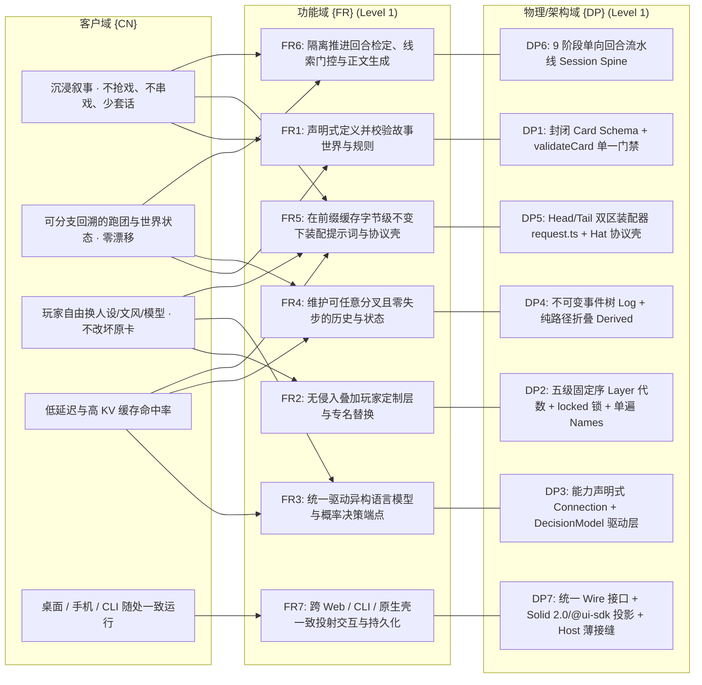
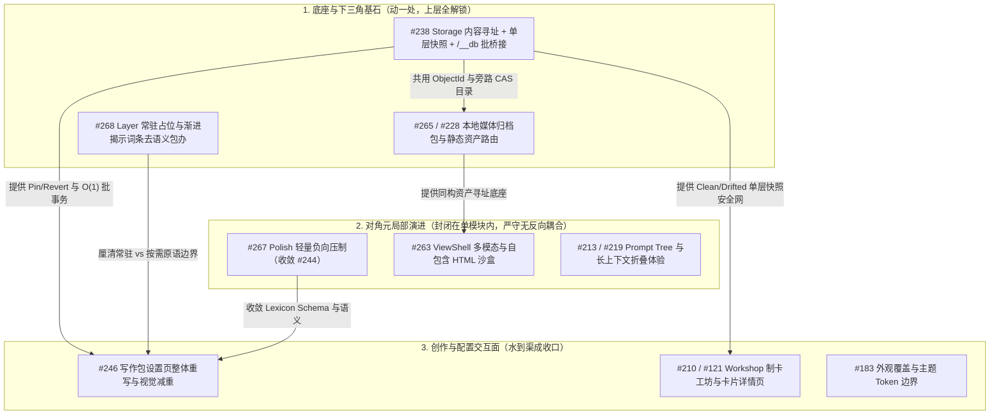
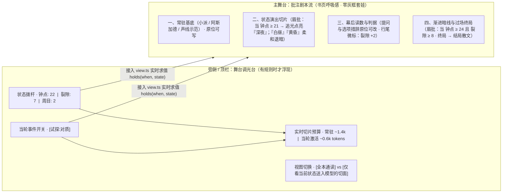

# MIT 公理设计架构审查与近期演进、Workshop 设计讨论记录

2026-11-27，基于 `main`（`fc66fd1`，`v0.11.1` 之后；覆盖全仓 5 个核心包共 197 个 `.ts/.tsx` 源文件、Go 宿主层及当前开放的 20 个 GitHub Issues）。

本文归档两轮连续讨论：
- **上篇（架构审查）**：从 MIT 教授 Nam P. Suh 的**公理设计理论**（Axiomatic Design）出发，逆向提取 `effect-tavern` 的功能需求（FRs）与设计参数（DPs），判定多层级设计矩阵 $[A]$ 的几何形状，结合静态依赖图实测评估耦合与模块内聚度，并定位现存的 4 处非对角张力点。
- **下篇（路线与设计讨论）**：将当前开放的 Issue 投影回设计矩阵，厘清“单点对角演进（如 Polish `#267`、ViewShell 扩展 `#263`）”与“底座重构（如 Storage `#238`、中立化 `#268`）”的边界与推进次序，并围绕最烧脑的 **Workshop（制卡工坊，`#210` / `#121`）** 探讨其读写定位、三层表达力阶梯与交互细腻度。

---

# 上篇：MIT 公理设计（Axiomatic Design）架构审查

## 一、 背景对照：传统酒馆的“强耦合稠密矩阵”与本项目的公理化起点

对照 [`GLOSSARY.md`](../GLOSSARY.md) 第 3 节（*Legacy Tavern Concepts & Negative Constraints*），`effect-tavern` 的核心架构动机本质上是将传统酒馆生态（SillyTavern 等）违反**第一公理**（独立公理，Independence Axiom）的**强耦合设计矩阵**（Coupled Matrix）重构为**无耦合对角矩阵**（Uncoupled）与**准耦合下三角矩阵**（Decoupled Lower-Triangular）。

传统酒馆的典型功能耦合关系可表示为：

$$
\begin{bmatrix}
FR_{\text{文风控制}} \\
FR_{\text{协议破限/预填}} \\
FR_{\text{状态栏追踪}} \\
FR_{\text{世界书检索}} \\
FR_{\text{KV 缓存复用}}
\end{bmatrix}_{\text{Legacy}}
=
\begin{bmatrix}
X & X & X & 0 & 0 \\
X & X & 0 & 0 & 0 \\
X & 0 & X & X & 0 \\
X & 0 & X & X & X \\
0 & 0 & X & X & X
\end{bmatrix}
\begin{bmatrix}
DP_{\text{单次对话补全}} \\
DP_{\text{大杂烩 Preset}} \\
DP_{\text{尾块 MVU + 正则脚本}} \\
DP_{\text{蓝绿灯关键词扫描}} \\
DP_{\text{楼层深度插入 @D4}}
\end{bmatrix}
$$

- **对称与环状非对角元 $X$**：单次对话补全同时承担写小说与输出 `<status>` 变量块，改状态提示词会污染文风，调采样参数又导致正则抓取失败；正文顺嘴提及某词触发蓝绿灯世界书，注入词条又反过来改变下文并递归触发新词条；`@D4` 楼层深度插队每轮篡改历史消息前缀，直接击穿供应商 KV 缓存。

---

## 二、 四域映射与顶层 FR / DP 提取（Level 1）

按公理设计的四域模型（客户域 $\{CN\} \to$ 功能域 $\{FR\} \to$ 物理/架构域 $\{DP\} \to$ 过程/验证域 $\{PV\}$），提取解决方案中立的 7 项顶层功能需求及其对应的架构原语（按消元拓扑序排列）：

| 拓扑序 | 功能需求 $FR_i$（What） | 设计参数 $DP_i$（How） | 核心承载模块 |
| :---: | :--- | :--- | :--- |
| **1** | **$FR_1$**：声明式建模单人/群像/大世界的叙事素材、机械规则与受控视图，并在入口拦截非法结构 | **$DP_1$**：封闭 `Card` Schema、`Cond`/`Effect_` 表达式树、无脚本 `ViewShell` AST 与值级 `validateCard` 门禁 | [`card.ts`](../packages/runtime/src/card.ts)、[`cond.ts`](../packages/runtime/src/cond.ts)、[`product.ts`](../packages/runtime/src/product.ts)、[`view-template.ts`](../packages/runtime/src/view-template.ts)、[`author.ts`](../packages/runtime/src/author.ts) |
| **2** | **$FR_2$**：允许玩家独立叠加文风开关、写作包、人设与专名替换，绝不破坏卡片规则或引发宏递归 | **$DP_2$**：五级优先级 `Layer` 代数（`defaultPack → card → packs → local → persona`）+ `locked()` 剥离锁 + 单遍无递归 `Names` | [`layer.ts`](../packages/runtime/src/layer.ts)、[`fragment.ts`](../packages/runtime/src/fragment.ts)、[`names.ts`](../packages/runtime/src/names.ts) |
| **3** | **$FR_3$**：统一驱动异构供应商的对话补全、原生工具流与零生成概率判别 | **$DP_3$**：能力类型化 `Connection` 编译（Anthropic / OpenAI 兼容 / Gemini）与独立 `DecisionModel` 通道 | [`providers.ts`](../packages/provider/src/providers.ts)、[`stage.ts`](../packages/provider/src/stage.ts)、[`decision.ts`](../packages/provider/src/decision.ts) |
| **4** | **$FR_4$**：支持任意历史回合零拷贝分叉、重抽、改词、改文与改值，且分支状态与摘要永不失步 | **$DP_4$**：仅存输入/种子/产物的不可变追加修订树 `Log` + 基于 `WeakMap` 记忆化的根到节点纯函数路径折叠 `Derived` | [`log.ts`](../packages/runtime/src/log.ts)、[`journal.ts`](../packages/runtime/src/journal.ts)、[`derived.ts`](../packages/runtime/src/derived.ts)、[`world.ts`](../packages/runtime/src/world.ts)、[`history.ts`](../packages/runtime/src/history.ts) |
| **5** | **$FR_5$**：按阶段受众精准投喂上下文、适配模型续写握手，同时保证跨轮次与跨分支 KV 前缀缓存字节级稳定 | **$DP_5$**：单一 `request.ts` 双区（`head` 静态前缀 + 定长区间折叠 + 追加 `transcript` + `tail` 动态尾区）三断点装配 + `Hat` 协议壳 | [`request.ts`](../packages/runtime/src/request.ts)、[`trace.ts`](../packages/runtime/src/trace.ts) |
| **6** | **$FR_6$**：在不让正文篡改数值、不让后台指令污染正文的前提下完成单回合推进 | **$DP_6$**：按卡片声明自动启停的 9 阶段固定拓扑流水线（`lookup → decide → settle → gate → direct → narrate → check → polish → record`） | [`session.ts`](../packages/runtime/src/session.ts)、[`context.ts`](../packages/runtime/src/context.ts)、[`polish.ts`](../packages/runtime/src/polish.ts) |
| **7** | **$FR_7$**：在独立服务端、无头 CLI、Vite 开发态与桌面/移动端 WebView 内提供一致的持久化与流式交互 | **$DP_7$**：SQLite 文档库 + `Wire`（`Request → Response`）同构接缝 + Solid 2.0/`@ui-sdk` 响应式投影 + MyGo `Host` 桥接 | [`serve.ts`](../packages/server/src/serve.ts)、[`library.ts`](../packages/server/src/library.ts)、[`store.ts`](../packages/client/src/store.ts)、[`entry.ts`](../packages/app/web/entry.ts) |

---

## 三、 设计矩阵 $[A]$ 形状判定与静态依赖实证

### 3.1 Level-1 系统设计矩阵（下三角准耦合 + 左上角无耦合对角块）

记 $X$ 为强控制/先决依赖，$x$ 为受控弱单向参数依赖，`·` 为严格正交（$\partial FR_i / \partial DP_j = 0$）：

$$
\begin{bmatrix}
FR_1\text{ 卡片规则建模} \\
FR_2\text{ 玩家分层定制} \\
FR_3\text{ 模型端点连接} \\
FR_4\text{ 树状历史派生} \\
FR_5\text{ 缓存提示装配} \\
FR_6\text{ 多阶段回合执行} \\
FR_7\text{ 多宿主持久化与呈现}
\end{bmatrix}
=
\begin{bmatrix}
\mathbf{X} & \cdot & \cdot & \cdot & \cdot & \cdot & \cdot \\
x & \mathbf{X} & \cdot & \cdot & \cdot & \cdot & \cdot \\
\cdot & \cdot & \mathbf{X} & \cdot & \cdot & \cdot & \cdot \\
X & x & \cdot & \mathbf{X} & \cdot & \cdot & \cdot \\
x & X & x & X & \mathbf{X}^{\dagger} & \cdot & \cdot \\
X & X & X & X & X & \mathbf{X} & \cdot \\
X & x & x & X & x & X & \mathbf{X}
\end{bmatrix}
\begin{bmatrix}
DP_1\text{ Card Schema} \\
DP_2\text{ Layer + Names} \\
DP_3\text{ Connection} \\
DP_4\text{ Log + Derived} \\
DP_5\text{ Request + Hat} \\
DP_6\text{ Session Spine} \\
DP_7\text{ Server/Client/App}
\end{bmatrix}
$$

1. **严格下三角矩阵（Decoupled / Quasi-Coupled Design）**：主对角线右上方全部为零，满足第一公理。只要遵循 $DP_1 \to DP_7$ 的自然层级演进，下游变动（改 UI、换宿主、调路由模型）绝不会反向破坏上游的卡片规则、日志树不变量或写作包。
2. **左上角 $3 \times 3$ 近似纯对角块（Uncoupled Block）**：作者写 `Card`（$DP_1$）、玩家配 `Layer / Pack / Persona`（$DP_2$）、玩家配 `Connection / Provider`（$DP_3$）三者彼此正交（仅 $A_{21}=x$ 对齐已知 `Slot` 与 `Product` ID，且经 `locked()` 与 `Resolved.dropped` 兜底绝不抛错崩局）。

### 3.2 全仓静态导入图 Tarjan 强连通分量（SCC）实测

对全仓 5 个包共 197 个 `.ts/.tsx` 源码文件执行静态与动态值导入扫描及 Tarjan 算法检测：

| 包名 | 源文件数 | 包内值导入环（`SCC > 1`） | 跨包值依赖方向 | 过程域机械防线（$PV$） |
| :--- | :---: | :---: | :--- | :--- |
| `@effect-tavern/provider` | 16 | **0** | `∅`（零跨包依赖，最底层源点） | `packages/provider` `verify` |
| `@effect-tavern/runtime` | 38 | **0** | 仅依赖 `provider` | `test/browser.ts` 无 Node/Bun 全局沙箱校验 + `vite.config.ts` 限制导入 |
| `@effect-tavern/server` | 46 | **0** | 依赖 `provider`、`runtime` | `vp check` + `server` `verify` |
| `@effect-tavern/client` | 89 | **0** | 仅依赖 `runtime/src/*` 与 `provider` 纯子路径；零 `server`/`app`/`node:*` 依赖 | [`packages/client/test/imports.ts`](../packages/client/test/imports.ts) 传递闭包阻断 |
| `@effect-tavern/app` | 8 (+Go) | **0** | Web 入口打包 `server/src/host.ts` 与 `client`，经 `Host` 接口单向调用 | `packages/app/test/page.ts` |

全仓 197 个源文件实现了 **0 包内循环依赖、0 跨包循环依赖**，实现层依赖矩阵与概念层下三角设计矩阵严格一致。

### 3.3 Level-2 之字形分解（Zigzagging）：9 阶段回合流水线矩阵

对 $FR_6 / DP_6$（单回合推进）下钻一层，可得 [`session.ts`](../packages/runtime/src/session.ts) 的 $9 \times 9$ 子矩阵：

$$
\begin{array}{c|ccccccccc}
[A]_{\text{Turn}} & DP_{6.1}\text{ lookup} & DP_{6.2}\text{ decide} & DP_{6.3}\text{ settle} & DP_{6.4}\text{ gate} & DP_{6.5}\text{ direct} & DP_{6.6}\text{ narrate} & DP_{6.7}\text{ check} & DP_{6.8}\text{ polish} & DP_{6.9}\text{ record} \\
\hline
FR_{6.1}\text{ 按需检索背景} & \mathbf{X} & \cdot & \cdot & \cdot & \cdot & \cdot & \cdot & \cdot & \cdot \\
FR_{6.2}\text{ 识别机械动作} & \cdot & \mathbf{X} & \cdot & \cdot & \cdot & \cdot & \cdot & \cdot & \cdot \\
FR_{6.3}\text{ 确定性骰点结算} & \cdot & X & \mathbf{X} & \cdot & \cdot & \cdot & \cdot & \cdot & \cdot \\
FR_{6.4}\text{ 解锁地板与开窗} & x & \cdot & X & \mathbf{X} & \cdot & \cdot & \cdot & \cdot & \cdot \\
FR_{6.5}\text{ 必讲/可讲与导演基调} & \cdot & \cdot & x & X & \mathbf{X} & \cdot & \cdot & \cdot & \cdot \\
FR_{6.6}\text{ 流式渲染叙事正文} & X & \cdot & x_{\text{band}} & X & X & \mathbf{X} & r_1 & \cdot & \cdot \\
FR_{6.7}\text{ 核验禁令与必讲线索} & \cdot & \cdot & \cdot & X & X & X & \mathbf{X} & \epsilon & \cdot \\
FR_{6.8}\text{ 局部擦除散文套话} & \cdot & \cdot & \cdot & \cdot & \cdot & X & \cdot & \mathbf{X} & \cdot \\
FR_{6.9}\text{ 抽取读数与世界事务} & x & \cdot & x & \cdot & \cdot & X & \cdot & x & \mathbf{X}
\end{array}
$$

- **拓扑排序消元**：`settle` 排在 `gate` 之前（“一剑挑破衣衫露出刺青”，本轮结算产物立刻可触发当轮开窗），恰好将依赖项翻折至对角线下方；左上角 `lookup` 与 `decide` 构成 $2 \times 2$ 纯对角无耦合块；`narrate` 仅接收满足条件的散文 `Band`（$x_{\text{band}}$）且对数值无写权限（$A_{6.3, 6.6} = 0$）。
- **第二公理（信息公理，Minimize $I = \log_2(1/p)$）体现**：用确定性代码（`settle`，$I = 0$）、写后分类/选择题（`check` / `Readout`）与 `DecisionModel` 概率前向快筛替代“单次生成顺带吐 JSON”，大幅收窄系统响应方差，提高落入设计容差带的概率 $p$。

---

## 四、 现存的 4 处真实非对角张力点与模块内聚度评估

### 4.1 四处残余耦合 / 工程折中点

1. **`DP_5` 内部硬物理耦合：`Hat.wrap: true` 击穿 KV 前缀缓存（$A_{\text{缓存}, \text{ToolWrap}} = X$）**
   - 见 [`request.ts:28-32`](../packages/runtime/src/request.ts#L28-L32)。开启工具包裹模式后，所有上下文消息转入交付工具的 `description`；由于各家大模型供应商在底层序列化时均将 `tools[]` 置于 `messages[]` 之前，每轮变化的上下文导致第 0 字节起的工具定义改变，被迫关闭全部缓存断点。属于受制于上游 Wire 协议顺序的物理约束耦合，当前已严格隔离在 `wrap: true` 分支内。
2. **`[A]_{\text{Turn}}$ 微弱上三角项：`polish` 在 `check` 之后改句且免复检（$A_{6.7, 6.8} = \epsilon$）**
   - 见 [`session.ts:7-12`](../packages/runtime/src/session.ts#L7-L12)（`#63`）。若将 `polish` 置于 `check` 之前，一旦 `check` 触发重写就会形成 `narrate ↔ polish ↔ check` 回环并多耗一次调用；置于 `check` 之后虽省去一次调用，但存在局部改写擦边违反 `guard` 或冲淡 `must` 措辞的极小概率 $\epsilon$。当前靠对话掩码与局部切片将 $\epsilon$ 压在可控边界内。
3. **工坊 `Manuscript` 与完整 `Card` 的双向透镜约束**
   - 见 [`manuscript.ts`](../packages/client/src/manuscript.ts)。无草稿直写模式下，工坊视图层必须严格满足双向透镜定律 `cardOf(card, manuscriptOf(card)) === card`（未展示字段原位透传、未触碰块逐字符保真），任何新增编辑控件一旦破坏该等式即会静默损伤底层机械结构。
4. **`packages/app` 页内服务端 SQL 粒度与主线程帧率的跨层耦合**
   - 见 [`packages/app/web/sqlite.ts`](../packages/app/web/sqlite.ts)。为让整套 `@effect-tavern/server` 零分叉运行在系统 WebView 内，客户端通过主线程同步 `XMLHttpRequest`（`POST /__db, async = false`）模拟 `bun:sqlite`，使服务端单次 API 的 SQL 执行条数直接映射为主线程阻塞时长，需靠批量接口（如 `GET /locals`）与后续批事务模式补偿。

### 4.2 核心模块内聚度光谱

| 模块 / 子系统 | 内聚等级 | 评价与扇入/扇出特征 |
| :--- | :---: | :--- |
| `runtime/src/log.ts` | **功能内聚（极高）** | 纯不可变树代数，零业务概念，跨 `runtime / server / client` 同构复用的极深模块。 |
| `runtime/src/layer.ts` | **功能内聚（极高）** | 唯一作者优先级序、解码安全锁 `locked()` 与非抛错 `dropped` 诊断高度收敛。 |
| `runtime/src/derived.ts` | **功能/信息内聚（高）** | 独占所有路径折叠派生事实，以对象引用 `WeakMap` 闭环解决分支切换与祖先修订失效（Fan-out: 9）。 |
| `runtime/src/request.ts` | **功能内聚（高）** | 独占全阶段提示词骨架、XML 标签词汇、三处缓存断点与 `Span` 源码溯源映射。 |
| `provider/src/*` | **功能内聚（高）** | 16 个小模块专注模型协议编译、断点翻译与 `Fault` 分类，对上层卡片/故事完全无知。 |
| `server/src/wire.ts` + `reach.ts` | **功能内聚（极高）** | `Request → Promise<Response>` 抽象接缝，使 CLI 进程内直调、HTTP 监听、Vite 中间件与 WebView 页内服务完全同构（Fan-in: 5）。 |
| `runtime/src/session.ts` | **顺序内聚（中高）** | 1,835 行、Fan-out **23**，串联 9 阶段的主编排器；需持续守住“策略归子模块、编排留 session”的边界。 |
| `server/src/library.ts` + `serve.ts` | **通信内聚（中）** | 围绕同一 SQLite `Data` 实例聚合全部安装级资产读写（937 行 / 721 行），职责面较宽（含少量供应商列表探测逻辑）。 |
| `client/src/store.ts` | **通信内聚（中）** | 客户端响应式 Atom 状态中心（Fan-in: **36**），混合故事树/流式草稿、全局设置与首页标签页状态。 |

---

# 下篇：开放 Issue 演进路线与 Workshop（制卡工坊）设计讨论

## 五、 开放 Issue 在设计矩阵上的分诊与排期次序

将当前开放的 20 个 Issue 投影回上述设计矩阵，可分为三条清晰的演进脉络：

### 5.1 单模块独立演进的守界红线（`#267` Polish 与 `#263` ViewShell 扩展）

- **`#267` Polish 轻量负向压制（取代 `#244` 重型工作流）**：
  将重型多轮润色拉回“快筛 + 句群微调 + 60 分顺畅线”，避免了串行延迟爆炸与上三角耦合放大。实施关键在于：保持 `check / polish / record` 共享 `<world>` 头部缓存断点不动，在断点后的 `reference` 区向 `polish` 透传生效的 `<writing_guidelines>`（零缓存损失修复“盲改磨平文风”），并将同段相邻命中句合并为完整句群 `<target>`、放开纯注水句删减。
- **`#263` 多模态与自包含 HTML 沙盒附件（承接 `#228` / `#237`）**：
  - **沙盒状态边界铁律**：无脚本 `ViewShell` 天然无状态；引入 `iframe sandbox="allow-scripts"` 自包含 HTML 后，必须严守“**沙盒零私有持久化存储**”——沙盒只能作为 `(NodeProjection, MediaUrls, ThemeTokens) → UI` 的受控投影并通过 `postMessage` 上报受控意图（填词、空闲最新轮发起标准动作、控制宿主无头音频通道）。凡需跨轮或随 `swipe / checkout` 切分支同步的状态一律归卡片 `fields / world`，杜绝重演旧酒馆 iframe 状态失步。
  - **解决 `ri.yaml` 历史楼与最新楼视图叠床架屋（`#263` 评论 1）**：支持 `residency: "past"`，或规定当 `latest` 聚合视图声明 `consumes: ["inner"]` 时仅在最新楼层遮蔽（shadow）同产物的 `turn` 视图，退入历史楼层后自动回落为轻量 `turn` 折叠条。

### 5.2 为什么 `#238` Storage Phase 1 是当前最高杠杆的“先手棋”？

目前 [`runtime/src/storage.ts`](../packages/runtime/src/storage.ts)（规范化 JSON 哈希与快照契约）、[`server/src/checkpoint.ts`](../packages/server/src/checkpoint.ts)（`decideCheckpoint` 双侧乐观锁与 `layerDelta` 稀疏差集）与 [`server/src/stored-call.ts`](../packages/server/src/stored-call.ts)（含 `WrapSection.body` 逐码元切片的双向脱水器）三块核心纯函数均已就位，仅差接入 [`sqlite.ts`](../packages/server/src/sqlite.ts) 与 [`packages/app/db.go`](../packages/app/db.go)。

优先推进 **`#238` Phase 1（`db.go` `batch` 模式 + `blob` / `checkpoint` 表落地，暂缓 Phase 2 `call` 去重）** 能一石三鸟：
1. **化解上篇第 4 处耦合**：`db.go` 通用批事务直接将移动端/桌面端 WebView 跨桥降为 $O(1)$ 常数次；
2. **补齐无草稿编辑的后悔药**：直接为卡片工坊（`#210`）、写作包（`#246`）、Hat、人设与单卡本地覆盖提供统一的 `Clean | Drifted` 单层快照（`Pin / Revert`），无需复活沉重的 `drafts` 表；
3. **统一本地媒体寻址地基**：主库 `tavern.db` 存 UTF-8 文本 `blob`，旁路目录 `<UserData>/cas/sha256/ab/<hash>` 存二进制媒体，顺势打通 `#265`（无图床创作者本地图片目录/归档包导入）与 `#263` 多模态静态路由。

**推荐近期推进序列**：
`#238 Phase 1` $\longrightarrow$ `#268` + `#267` 并行微创收口 $\longrightarrow$ `#246` 写作包设置页一次重写到位。

---

## 六、 Workshop（制卡工坊）前端的三个核心问题破局

回顾工坊走过的三轮形态——`#121`（卡片详情页 + 披露开关）、[`docs/workshop-components-design.md`](../docs/workshop-components-design.md)（二维 7 胶囊画布 + 组件内页表单）、[`packages/client/src/workshop.tsx`](../packages/client/src/workshop.tsx) V0（三种纯文本直写）与 `#210` 的两阶段反思——并以复杂样卡 [`samples/life-of-pi/life-of-pi.yaml`](../samples/life-of-pi/life-of-pi.yaml) 为标尺，可以对三个核心追问给出清晰解答。

### 6.1 追问一：面对创作者和普通用户，它是用来「读」的、「写」的，还是混合的？

**核心判断：底座必须是「100% 无损、可交互显影的读」，表面提供「按意图分层解耦的写」——打破“读写必须对称”的隐含假设。**

过去之所以在两个极端之间卡住，是因为默认了“**凡是在界面上展示出来的结构，都必须配一套等粒度的 GUI 表单去写它**”：
- 一旦要求 GUI 表单可写，面对 `life-of-pi.yaml` 中“单个 `probe` 选项同时写 `今日试探 +2`、`裂隙 +2` 并抛出 `试探:对质` 事件”、“`闪断冷却` 单轮锁存器”、“复合 `all` 条件与 `passages` 纪元边界”，界面必然退化为繁琐的“鼠标搓 JSON AST”；
- 一旦为了干净砍掉表单，V0 的 `manuscript.ts` 又连带把带 `when` 的段落、多层 `lore`、`passages` 与 `readouts` 全部隐身了——打开《Life of Pi》只剩三段常驻设定，整张卡真正的戏剧结构在工坊里完全看不见。

对照真实用户行为：
1. **普通玩家**：开局前看设定基调；通关或好奇拨开 `#121` **披露开关**后，想把这张卡当作一本《**可交互剧本设定集**》来鉴赏全貌，偶尔顺手改一句称呼、修个错字或微调一段开场。
2. **重度创作者与 AI 协作者（含使用 `card-author` Skill / YAML 的作者）**：复杂接线往往在源码或借助编译完成，他们在前端最不可替代的刚需同样是「**交互式读与状态仿真**」（快速确认阈值两侧到底哪段文字亮起、Token 预算多少）外加「**顺手在原位推敲散文与判据字眼**」。
3. **散文先行创作者**：需要白纸黑字写好段落后，用一句自然语言调用 `compile` 挂上常见弧线。

因此，**「读」必须 100% 覆盖整张 `Card` 的全部结构并支持状态仿真；而「写」不必强求用同一种 GUI 表单覆盖全部 AST**。

### 6.2 追问二：它的表达力该怎么设计？（三层非对称表达力阶梯）

顺应 [`docs/workshop-brief.md`](../docs/workshop-brief.md)“语文归作者，封闭接线归代码/编译”的分野，将写能力拆为三层正交阶梯，读写同一份书架 `Card` 真值：

| 阶梯 | 负责表达的内容 | 交互方式 | 表达力覆盖 |
| :--- | :--- | :--- | :---: |
| **L1 · 全语文槽原位直写** （扩充 `manuscript.ts` 透镜） | 卡片内**全部**人类语言字段：常驻章节、开场、单层词条，**以及**带 `when` 的阶段散文（`Band`）、多层 `Lore` 各层正文、`Passages` 过场正文、`Readout / Action` 的判据提问与选项措辞、`Guard` 禁令。 | 在剧本流中全部可见、全部可原位落笔编辑（保持 800ms 自动保存）；其挂载的机械条件（`when / unlock / do`）默认渲染为**只读的自然语言舞台眉批**（基于 `phrase.ts`），不展开为 AST 表单。 | **100% 人类语文覆盖** （日常改文、精修判据零死角） |
| **L2 · 高频弧线 + 受锁 AI 编译** （对应 `#210` 阶段二） | 非技术作者从零搭建最高频的两类结构： ① **状态阶段弧线**（几段递进散文 + 推进/回退行为） ② **渐进暗线阶梯**（首句 Hook + 逐层揭开的秘密） | 先写散文段，选中后用一句话自然语言走 `POST /author/compile`（或极简档位条）生成封闭接线；生成的空白判据槽原位亮起温和提示，填完即过闸。 | **~80% 常见机制从零创作** |
| **L3 · 双射 YAML 源码缓冲** （对应 `#210` 阶段一） | 任意复合布尔树、单选项多变量联动、锁存器、`passages` 纪元摘要、`catalogs`、`ViewShell` HTML/CSS。 | 独立编辑缓冲（允许中间语法残缺），实时跑 `checkCard` 定位诊断，点击「应用」写回书架并重投影剧本视图；配合 `#238` 单层快照随时一键 `Revert`。 | **100% Schema 极限表达力** |

### 6.3 追问三：它要表达的形式和细腻度是什么样的？

核心隐喻：**放弃“后台表单 / 节点连线器”，做成一本「带舞台调光台的批注剧本（Annotated Playscript + Stage Dimmer Board）」**，让 `#121`（玩家掀幕鉴赏）与 `#210`（作者调试创作）在同一个器物上自然统一：

四个决定质感的细腻度锚点：
1. **无规则时彻底隐形，有规则时一拨显影**：纯散文卡打开就是一页安静的手稿，调光台完全不出现；带状态字段的卡旁侧浮出轻量拨杆，拖动 `裂隙` 跨过阈值时，主剧本流中命中的段落温润亮起、互斥段落柔和退暗，角落若有立绘或 `ViewShell` 同步切换神态；切到「仅看当轮切面」即可一眼确认送入模型的真实上下文，3 秒定位“条件没命中”还是“命中了但词没写好”。
2. **正文是墨，机制是眉批**：主栏彻底摒弃灰底框套灰底框的表单感，只有作者撰写的散文与判据使用正文墨色（`--ink`）与阅读字阶；条件与状态增减一律退为段落上方或行尾的次级色小号场记眉批（`--ink-3`），顺读如剧本，点按眉批才唤出 `compile` 意图框或源码定位。
3. **空白判据的温和填空引导**：`compile` 生成空判据槽触发 `empty-text` 门禁时，书架原卡保持安全不动，界面不弹报错红框，仅在该选项行以虚线底边与琥珀色圆点提示补全措辞，填完自动过闸落盘。
4. **单层快照托底的无压试错**：接通 `#238` Phase 1 后，顶栏仅在偏离锚点时轻显 `已修改 · [回退] [定稿]`，无论是大胆跑 `compile` / `sort` 还是切源码大改，随时可一键无损退回干净基线。
